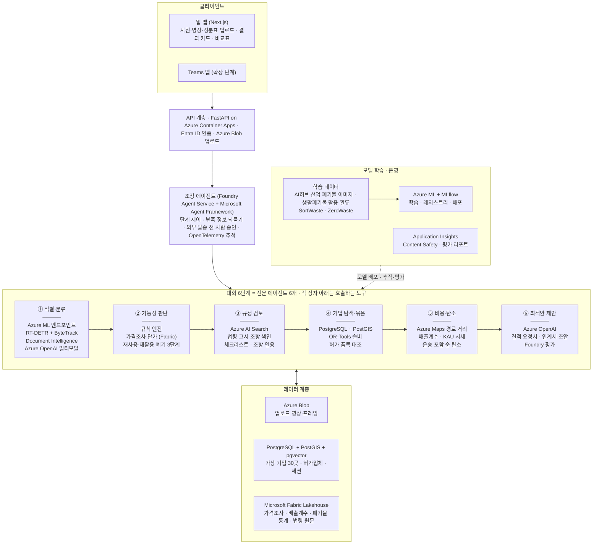
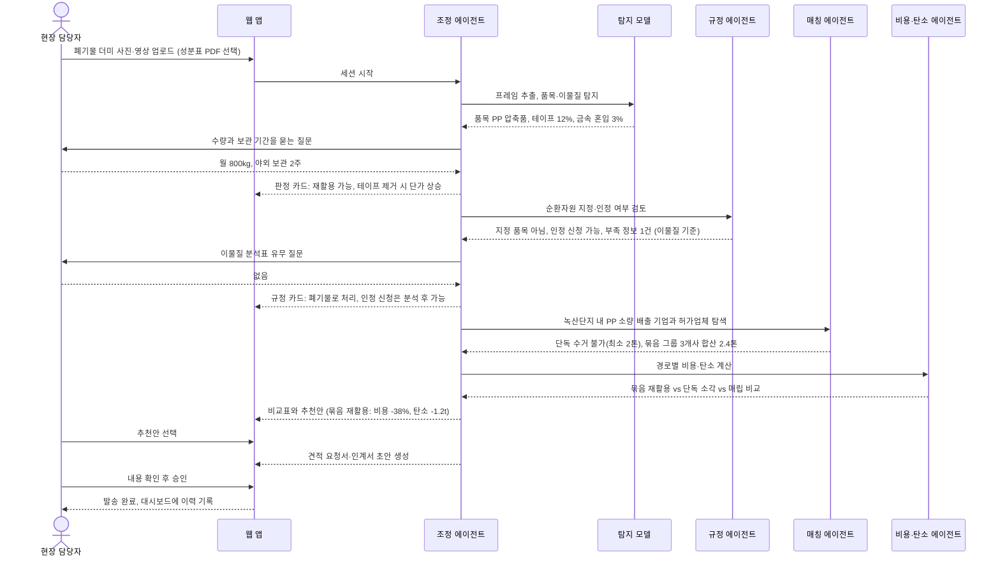
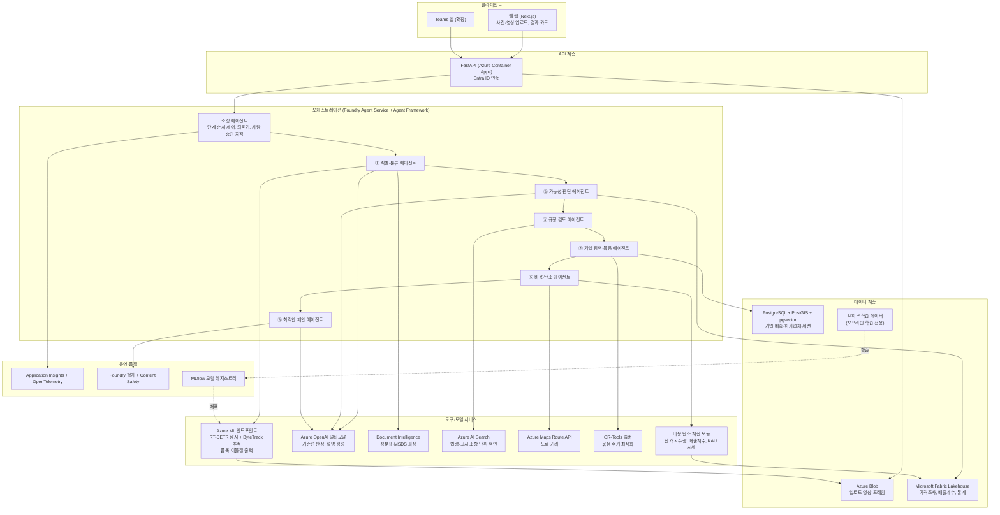

# Re:Source AI 설계안 v1

작성일: 2026-11-01
용도: 팀 회의 제출용 (주제, 데이터, 페인포인트, 아키텍처, 유저 플로우)

> **2026-11-09 갱신:** 이 설계안은 [설계안 v2](ReSource_AI_설계안_v2.md)로 대체되었다. 문제 정의는 [문제 정의 v2](문제정의_v2.md)를 따른다. 아래 본문은 기록으로 남기며 고치지 않는다.

---

## 1. 주제

**현장 영상 기반 산업 폐기물 등급 판정과 산업단지 묶음 수거 매칭 에이전트**

한 줄 정의: 중소 제조업체 담당자가 폐기물 더미를 스마트폰으로 찍으면, 에이전트가 품목과 오염도를 판정하고, 순환자원 해당 여부를 검토하고, 같은 산업단지 안에서 묶어 수거할 기업과 처리업체를 찾은 뒤, 처리 방식별 비용과 탄소를 비교해 최적안과 견적 요청서까지 만들어 주는 서비스.

| 항목 | 내용 |
|---|---|
| 대상 사용자 | 산업단지 입주 중소 제조업체의 환경·총무 담당자 (전담 인력이 없는 곳) |
| 대상 품목 | 대회 공지의 네 품목: 폐플라스틱, 금속 스크랩, 폐목재, 포장재 |
| 시연 지역 | 부산 녹산국가산업단지 (가상 기업 데이터를 이 단지 좌표에 배치) |
| 대회 파이프라인 대응 | 식별·분류 → 가능성 판단 → 규정 검토 → 업종·기업 탐색 → 비용·탄소 비교 → 최적안 제안의 6단계를 그대로 에이전트 6개로 구현 |

이 주제를 고른 이유: 대회가 제시한 6단계를 전부 구현하면서도, 입력이 사진과 영상이라는 점과 다대일 묶음 수거라는 점에서 다른 팀과 겹치지 않는다. 세 가지 페인포인트 모두 공개 자료로 실재가 확인되었다.

---

## 2. 해결하는 페인포인트

### 페인포인트 1. 오염 때문에 등급이 떨어지고 수거를 거부당한다

- 선별 후 20~30%가 오염과 훼손으로 재활용 불가 판정을 받는다 (세계일보, 2022).
- 2018년 수거 대란 당시 수거업체들은 "깨끗한 재활용품만 가져가겠다"는 조건을 걸었다 (뉴시스, 2018).
- 영세·중소 재활용업체 약 1만 곳이 여전히 손으로 선별한다 (머니투데이, 2023).
- 현장 담당자는 무엇을 얼마나 제거해야 등급이 오르는지 모른다.

**해결:** 영상에서 이물질을 탐지해 "테이프만 제거하면 단가가 얼마 오른다"처럼 작업 대비 수익이 가장 큰 제거 항목 하나를 지시한다.

### 페인포인트 2. 소량이라 재활용 업체가 수거하러 오지 않는다

- 한강유역환경청 소량 지정폐기물 수거 서비스는 방문 수수료가 회당 2만 원이고, 수거업체가 일정을 모아야 해서 한 달 이상 기다리는 경우가 있다 (강동구 안내문).
- 소량 배출 사업장은 전담 인력이 없어 위반율이 2022년 4.3%에서 2024년 11.8%로 올랐다 (영산강유역환경청, 2025).
- 이천시 공동처리 서비스는 소규모 공장을 제외했다. 바로 그 빈자리가 서비스의 자리다.

**해결:** 같은 산업단지 안에서 같은 품목을 소량 배출하는 기업을 묶어 업체의 최소 수거 물량을 넘기는 공동 수거 일정과 비용 분담안을 만든다.

### 페인포인트 3. 순환자원 제도는 열렸는데 중소기업이 못 쓴다

- 순환자원 인정 요건 완화 시행령은 2023년 1월 1일 시행되었고, 2024년 1월부터는 순환경제사회 전환 촉진법에 따라 환경부가 품목을 직접 지정·고시한다 (법률신문).
- 그러나 어떤 물질이 지정 품목에 해당하는지, 인정 신청이 가능한지 판단하는 일 자체가 중소기업에 부담이다.

**해결:** 법령과 고시를 조항 단위로 검색해 지정 품목 해당 여부와 인정 요건 충족 여부를 체크리스트로 진단하고, 부족한 정보는 사용자에게 되묻는다.

---

## 3. 사용 데이터

### 6단계별 데이터 매핑

| 단계 | 데이터 | 출처 | 용도 |
|---|---|---|---|
| 1. 식별·분류 | 산업 폐기물 이미지 (10종, 20만 건 이상) | AI허브 | 품목 탐지 모델 학습 |
| 1. 식별·분류 | 재활용품 분류 및 선별 데이터 (선별 영상 추출 프레임 29.9만 건) | AI허브 | 영상 프레임 환경 학습 |
| 1. 식별·분류 | SortWaste (컨베이어 원본 mp4, 2026), ZeroWaste (오염물 세그멘테이션) | 공개 학술 데이터 | 영상 파이프라인 검증과 미세 조정 |
| 2. 가능성 판단 | 생활폐기물 데이터 활용·환류 (이물질·다중포장재 유무 라벨, 55만 장) | AI허브 | 오염 판정 모델 학습 |
| 2. 가능성 판단 | 재활용가능자원 가격조사 (26개 항목, 8개 권역, 월간, 원/kg) | 공공데이터포털 (한국환경공단) | 형태별·권역별 단가 |
| 3. 규정 검토 | 폐기물관리법, 순환경제사회 전환 촉진법, 순환자원 지정 고시 | 국가법령정보센터 Open API | 조항 단위 RAG |
| 4. 업종·기업 탐색 | 공장등록 정보, 산업단지 입주기업 현황 | 한국산업단지공단 (공공데이터포털) | 묶음 수거 후보와 수요처 |
| 4. 업종·기업 탐색 | 가상 기업 부산물 데이터 | 운영위원회 제공 | 배출량·주기·보관 상태 |
| 4. 업종·기업 탐색 | 폐기물처리업 허가업체 목록 | 환경부·지자체 | 허가 품목 대조 |
| 5. 비용·탄소 비교 | 폐기물 발생·처리 통계 | 환경부·한국환경공단 | 처리 방식별 기준 비용 |
| 5. 비용·탄소 비교 | 온실가스 배출계수, 국가 LCI 데이터베이스 | 온실가스종합정보센터, 환경산업기술원 | 회피 배출량 계산 |
| 5. 비용·탄소 비교 | 배출권 거래 시세 (KAU) | 한국거래소 | 탄소 절감의 금액 환산 |
| 5. 비용·탄소 비교 | 도로 경로 거리 | Azure Maps | 운송 비용과 운송 배출 |
| 6. 최적안 제안 | 사업장폐기물 마감인계서 합성데이터 | AI허브 | 인계서 초안 양식과 항목 검증 |

### 데이터 관련 유의 사항

- AI허브 데이터는 로그인과 승인 절차가 필요하고, 폐플라스틱 이미지 데이터는 내국인만 신청할 수 있다. 신청을 가장 먼저 해 둔다.
- 산업 폐기물 이미지는 클래스 불균형이 심해 최소 클래스가 20장이라는 품질 진단이 공개되어 있다. 소수 클래스 증강과 가중치 조정을 발표에 명시한다.
- 가격조사 데이터는 오염 등급별이 아니라 가공 형태별(압축, 플레이크, 펠릿, 잉곳) 단가다. 등급 상승 효과는 "오염 제거 후 어느 형태로 납품 가능한가"로 환산해 계산한다.

---

## 4. 기술 스택과 선택 이유

원칙: 기술 목록이 아니라 "이 문제 때문에 이 기술이 필요했다"를 심사위원에게 설명할 수 있어야 한다.

### Microsoft 기술

| 문제 | 기술 | 선택 이유 |
|---|---|---|
| 역할이 다른 6단계 판단을 분리하고 실행 추적을 남겨야 함 | Microsoft Foundry Agent Service + Microsoft Agent Framework | Semantic Kernel과 AutoGen이 통합된 프레임워크라 멀티 에이전트 오케스트레이션과 트레이싱을 한 곳에서 처리한다 |
| 사진과 영상에서 품목·상태를 읽고 사용자에게 되물어야 함 | Azure OpenAI 멀티모달 모델 (Foundry 배포) | 학습 모델의 기준선이자, 학습 데이터에 없는 품목의 보완 판정 |
| 이물질 탐지 모델을 직접 학습해야 함 | Azure Machine Learning (AutoML 객체 탐지 또는 커스텀 학습, MLflow 추적) | Custom Vision은 2028년 9월 퇴역이 예고되어 있어 선택하지 않는다 |
| 법령 답변에 조항 출처를 붙여야 함 | Azure AI Search (하이브리드 검색 + 시맨틱 랭커) | 조항 단위 색인으로 환각을 막고 인용을 강제한다 |
| 성분분석표, MSDS, 인계서가 PDF와 사진으로만 존재함 | Azure AI Document Intelligence | 표와 수치를 구조화해 뒤 단계에 넘긴다 |
| 운송 거리가 비용과 탄소를 결정함 | Azure Maps (Route API) | 직선 거리가 아닌 도로 경로 거리로 계산한다 |
| 공공데이터 여러 개를 하나의 출처로 모아야 함 | Microsoft Fabric (Lakehouse, OneLake) | 가격 시계열, 배출계수, 통계를 단일 출처로 관리한다 |
| 답변 품질을 수치로 보여야 함 | Foundry 평가 도구 + Azure AI Content Safety | 근거 충실도와 인용 정확도를 측정한다 |
| 현장 담당자가 별도 앱 없이 써야 함 | Microsoft Teams 앱 (확장 단계) | 이미 쓰는 도구에서 질의한다 |
| 인증, 관측, 배포 | Microsoft Entra ID, Azure Monitor + Application Insights, Azure Container Apps, Azure Blob Storage | 엔터프라이즈 운영 기본 요소 |

### 오픈소스·엔터프라이즈 도구

| 역할 | 도구 | 선택 이유 |
|---|---|---|
| 객체 탐지 모델 | RT-DETR 또는 YOLO 계열 (PyTorch) | 실시간 영상 탐지 표준. Ultralytics YOLO는 AGPL이므로 라이선스를 확인하고, 문제가 되면 Apache 2.0인 RT-DETR을 쓴다 |
| 영상 객체 추적 | ByteTrack | 프레임 간 같은 객체를 묶어 판정을 안정시킨다 |
| 묶음 수거 최적화 | Google OR-Tools (Apache 2.0) | 최소 수거 물량 제약과 경로를 함께 푸는 조합 최적화 |
| 데이터베이스 | Azure Database for PostgreSQL + PostGIS + pgvector | 기업 좌표 공간 질의와 임베딩 검색을 한 DB에서 처리한다 |
| 모델 실험 관리 | MLflow (Azure ML 내장) | 실험 재현과 모델 레지스트리 |
| 백엔드 API | FastAPI (Python) | 에이전트 서비스와 모델 엔드포인트를 묶는 경량 API |
| 프런트엔드 | Next.js + React | 사진 업로드, 결과 카드, 비교표 화면 |
| 관측 | OpenTelemetry | 에이전트 호출 추적을 표준 형식으로 수집해 Application Insights로 보낸다 |
| 배포 | Docker, GitHub Actions, Bicep | 컨테이너 빌드와 Azure 리소스 코드화 |

---

## 5. 아키텍처 다이어그램

렌더링 결과: `아키텍처_다이어그램.png` (슬라이드용). 도구 단위 상세 연결은 부록 B 참고.

### 에이전트 역할과 입출력

| 에이전트 | 입력 | 출력 | 핵심 도구 |
|---|---|---|---|
| ① 식별·분류 | 사진·영상, 성분표 PDF | 품목, 재질, 수량 추정, 이물질 종류와 비율 | Azure ML 탐지 모델, Document Intelligence, Azure OpenAI |
| ② 가능성 판단 | ①의 출력, 가격조사 | 재사용·재활용·폐기 3단계 판정, 납품 가능 형태, 제거 작업 지시 1건 | Fabric 가격 데이터, 규칙 엔진 |
| ③ 규정 검토 | 품목, 성분, 거래 계획 | 순환자원 지정 품목 여부, 인정 요건 체크리스트, 부족 정보 질문, 조항 인용 | Azure AI Search |
| ④ 기업 탐색·묶음 | 품목, 수량, 위치 | 단독 수거 후보, 묶음 수거 그룹과 일정, 허가 품목 대조 결과 | PostGIS, OR-Tools |
| ⑤ 비용·탄소 | 후보 경로들 | 경로별 비용, 운송 포함 순 탄소, KAU 환산액 | Azure Maps, 배출계수 |
| ⑥ 최적안 제안 | ①~⑤ 종합 | 추천안 1개와 대안 2개, 근거 요약, 견적 요청서·인계서 초안 | Azure OpenAI, 평가 |

조정 에이전트는 각 단계에서 정보가 부족하면 사용자에게 되묻고, 견적 발송과 인계서 확정처럼 외부로 나가는 행동은 반드시 사람 승인을 거치게 한다.

---

## 6. 유저 플로우

### 시퀀스 다이어그램

### 화면 단위 흐름

1. **업로드 화면.** 담당자가 사진이나 짧은 영상을 올린다. 성분분석표가 있으면 함께 올린다.
2. **식별 결과 화면.** 탐지된 품목과 이물질이 영상 위에 표시된다. 에이전트가 수량과 보관 상태를 묻는다.
3. **판정 카드.** 재사용·재활용·폐기 중 하나와 그 근거, 그리고 "이것만 제거하면 단가가 오른다"는 작업 지시 1건이 나온다.
4. **규정 카드.** 순환자원 해당 여부와 체크리스트가 조항 인용과 함께 나온다. 부족한 정보는 질문으로 돌아온다.
5. **매칭 화면.** 지도 위에 단독 수거 후보와 묶음 수거 그룹이 표시된다. 허가 품목이 맞지 않는 업체는 경고 표시가 붙는다.
6. **비교표.** 처리 방식별 비용, 운송 포함 순 탄소, KAU 환산액이 한 표에 나온다. 가정은 표 아래에 명시된다.
7. **최적안과 문서.** 추천안을 고르면 견적 요청서와 인계서 초안이 생성된다. 담당자가 승인해야 발송된다.
8. **대시보드.** 월별 처리 이력, 절감 비용, 절감 탄소가 누적 표시된다.

---

## 7. 구현 범위

### MVP (대회 시연 범위)

- 입력: 사진과 30초 이내 영상, 성분표 PDF 선택.
- 품목: 폐플라스틱과 포장재를 끝까지 구현하고, 금속 스크랩과 폐목재는 식별과 규정 단계까지만 구현한다.
- 지역: 녹산국가산업단지 좌표에 가상 기업 30곳을 배치한다.
- 외부 발송: 모의 업체 메일함으로 보낸다.

### 확장 단계 (발표의 로드맵 슬라이드)

- Teams 앱 연동, 순환자원 인정 신청서 자동 생성, 산업단지 단위 대시보드, 폐GPU와 데이터센터 설비 품목 추가.

---

## 8. 리스크와 대응

| 리스크 | 대응 |
|---|---|
| 매칭과 판정에 정답 데이터가 없음 | 전문가 규칙으로 검증 세트 50건을 직접 만들고, Foundry 평가로 근거 충실도를 측정한다. 평가 방법 자체를 발표에 넣는다 |
| 단위와 수분 함량 혼동으로 경제성 계산이 틀림 | 정규화 모듈을 에이전트 앞단에 두고, 건조 중량 기준임을 화면에 명시한다 |
| 탄소 계산 방법론 논쟁 | 매립 대비와 신재 생산 대비 두 가지를 모두 계산하고 가정을 표시한다 |
| 대형 모델 호출 비용과 지연 | 식별과 정규화는 학습 모델과 규칙으로 처리하고, 규제 해석과 종합 판단에만 대형 모델을 쓴다 |
| AI허브 데이터 승인 지연 | 승인 전에는 SortWaste와 ZeroWaste로 파이프라인을 먼저 만든다 |
| YOLO 라이선스 | AGPL 문제가 있으면 Apache 2.0인 RT-DETR로 교체한다 |

---

## 부록 A. 근거 출처

- 세계일보 (2022): 선별 후 20~30% 재활용 불가 — https://www.segye.com/newsView/20221115515775
- 뉴시스 (2018): 깨끗한 재활용품만 수거 조건 — https://mobile.newsis.com/view/NISX20180403_0000271129
- 머니투데이 (2023): 영세 재활용업체 수작업 선별 — https://www.mt.co.kr/industry/2023/03/19/2023022708470141303
- 강동구: 소량 지정폐기물 수거 서비스 안내 — https://www.gangdong.go.kr/web/newportal/bbs/b_068/155127?baCategory1=U0072
- 영산강유역환경청 (2025): 소량 배출자 위반율 — https://www.asiae.co.kr/en/article/2025052010100525377
- 법률신문: 시행령 개정과 순환경제사회 전환 촉진법 — https://www.lawtimes.co.kr/news/articleView.html?idxno=184331
- 공공데이터포털: 재활용가능자원 가격조사 — https://www.data.go.kr/data/3076421/fileData.do
- AI허브: 산업 폐기물 이미지 — https://aihub.or.kr/aihubdata/data/view.do?currMenu=115&topMenu=100&aihubDataSe=data&dataSetSn=137
- AI허브: 재활용품 분류 및 선별 데이터 — https://aihub.or.kr/aihubdata/data/view.do?currMenu=115&topMenu=100&dataSetSn=71362
- AI허브: 생활폐기물 데이터 활용·환류 — https://aihub.or.kr/aihubdata/data/view.do?dataSetSn=71385
- AI허브: 사업장폐기물 마감인계서 합성데이터 — https://aihub.or.kr/aihubdata/data/view.do?aihubDataSe=extrldata&dataSetSn=71881
- 페블러스: 산업폐기물 데이터 품질 진단 — https://blog.pebblous.ai/story/dataclinic-report-131-industrialwaste-story-pb/ko/
- SortWaste — https://sortwaste.di.ubi.pt/
- ZeroWaste — https://arxiv.org/abs/2106.02740v2
- Microsoft Learn: Custom Vision 퇴역 안내 — https://learn.microsoft.com/en-us/azure/ai-services/Custom-Vision-Service/overview

---

## 부록 B. 상세 아키텍처 (도구 단위 연결)

슬라이드에는 본문의 요약 판을 쓰고, 질의응답 대비용으로 아래 상세 판을 둔다.

