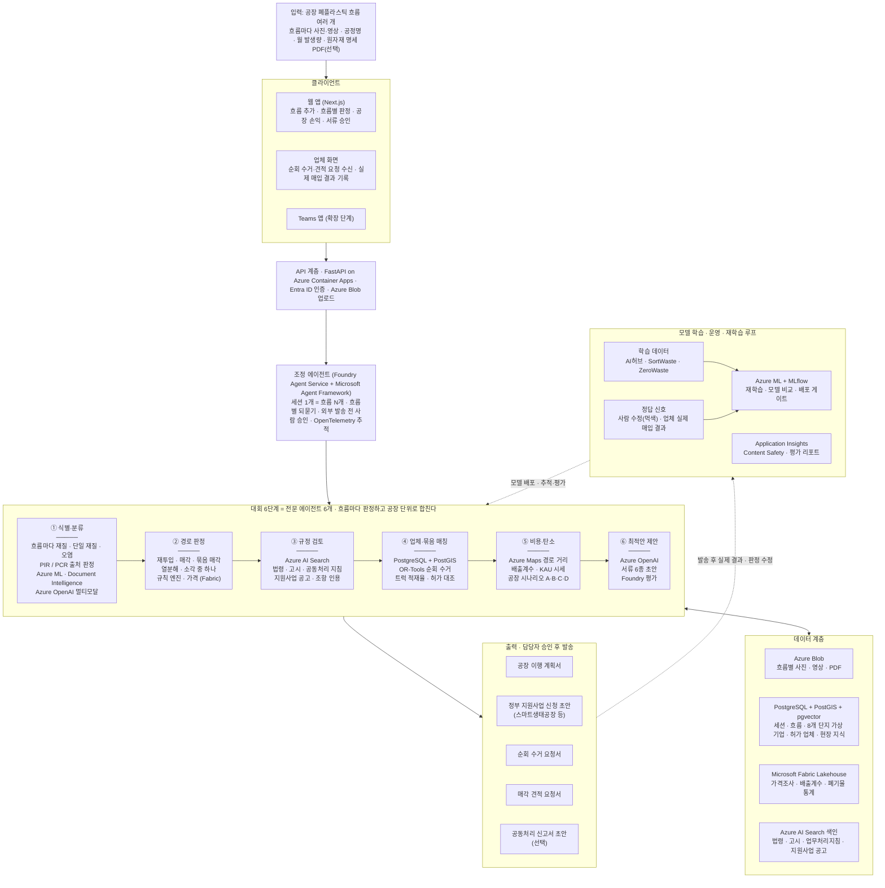
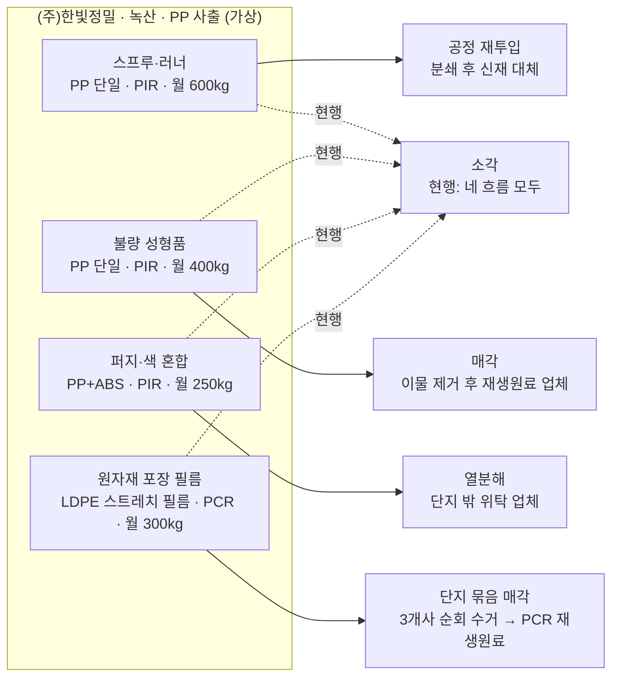
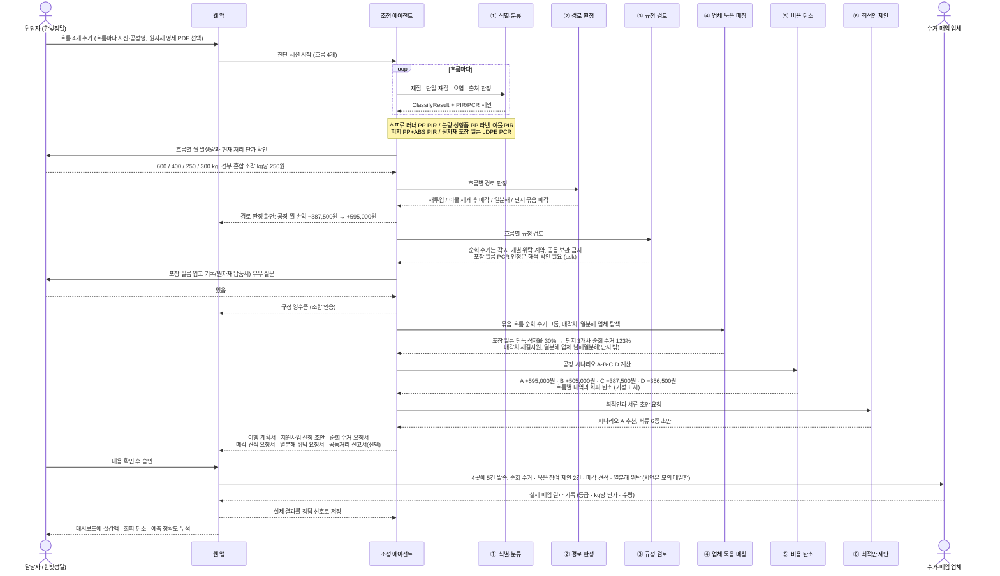
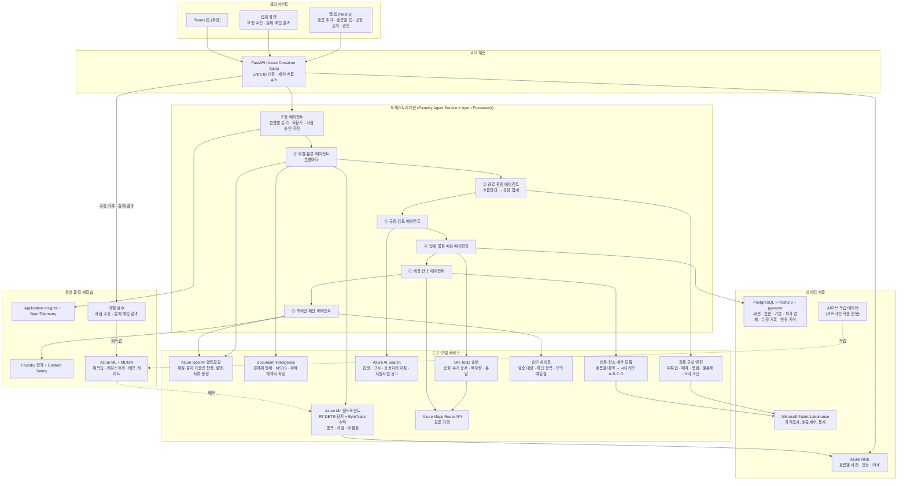

# Re:Source AI 설계안 v2

작성일: 2026-11-09
용도: 팀 검토용 (문제 정의 v2를 반영한 주제, 데이터, 아키텍처, 에이전트, 유저 플로우, 구현 범위, 리스크)
기준 문서: [문제 정의 v2](문제정의_v2.md). 이 문서와 어긋나면 문제 정의 v2를 따른다.
이전 판: [설계안 v1](ReSource_AI_설계안_v1.md) (기록으로 남긴다)

> 그림 안내: `아키텍처_다이어그램.png`와 `유저플로우_시퀀스.png`는 v1 기준 그림이다. v2 그림은 이 문서의 mermaid 코드로 다시 렌더링한다.

## 목차

- [v1 대비 바뀐 점](#v1-대비-바뀐-점)
- [1. 주제](#1-주제)
- [2. 해결하는 문제](#2-해결하는-문제)
- [3. 사용 데이터](#3-사용-데이터)
- [4. 기술 스택과 선택 이유](#4-기술-스택과-선택-이유)
- [5. 아키텍처](#5-아키텍처)
- [6. 유저 플로우](#6-유저-플로우)
- [7. 구현 범위](#7-구현-범위)
- [8. 리스크와 대응](#8-리스크와-대응)
- [부록 A. 근거 출처](#부록-a-근거-출처)
- [부록 B. 상세 아키텍처 (도구 단위 연결)](#부록-b-상세-아키텍처-도구-단위-연결)

---

## v1 대비 바뀐 점

| 항목 | v1 | v2 |
|---|---|---|
| 진단 단위 | 폐기물 더미 사진 한 장 | 공장의 폐플라스틱 흐름(Stream) 여러 개. 세션 하나에 흐름 N개가 들어간다 |
| 대상 | 산업단지 중소 제조업체, 네 품목을 고르게 | 부산·경남 고무·플라스틱 제조 중소기업, 폐플라스틱 중심 |
| 판정 결과 | 재사용·재활용·폐기 3단계와 제거 작업 1건 | 흐름별 갈 곳 5가지(공정 재투입·매각·단지 묶음 매각·열분해·소각)와 출처 구분(PIR·PCR) |
| 묶음 수거 | 최소 2톤을 넘기는 공동 수거 | 순회 수거 계약이 기본값. 최소 물량은 품목별 변수이고 트럭 적재율로 보여 준다. 공동처리 신고는 선택 |
| 비용·탄소 | 처리 경로별 비교 | 공장 단위 시나리오 A·B·C·D와 흐름별 내역 |
| 서류 | 견적 요청서, 인계서 초안 | 공장 이행 계획서, 정부 지원사업 신청 초안, 순회 수거 요청서, 매각 견적 요청서, (선택) 공동처리 신고서 초안 |
| 근거 | 페인포인트 3개 | 정부 기술진단(연 10곳)과 지원사업 자격(연 1,000톤 이상)이 닿지 않는 빈자리 |
| 지역 | 녹산 가상 기업 30곳 | 녹산 등 부산·경남 8개 산업단지 |
| 학습 | 언급 없음 | 사람 수정(먹색)과 업체 실제 매입 결과를 정답 신호로 쓰는 재학습 루프, 현장 지식 카드 |

---

## 1. 주제

**사업장 폐플라스틱 AI 순환 진단 에이전트**

한 줄 정의: **정부가 한 해 10곳에만 해 주는 사업장 폐플라스틱 순환 진단을, AI 에이전트로 모든 중소 제조기업에 제공한다.**

공장 담당자가 공정별 폐플라스틱 흐름을 찍어 올리면, 에이전트가 흐름마다 재질과 출처(PIR·PCR)를 판정하고, 갈 곳을 고르고, 규정을 확인하고, 매각처·열분해 업체·단지 내 순회 수거 그룹을 찾고, 공장 전체 손익과 회피 탄소를 계산한 뒤, 이행 계획서와 지원사업 신청 초안, 수거·견적 요청서까지 만든다. 외부 발송은 담당자 승인 후에만 한다.

| 항목 | 내용 |
|---|---|
| 대상 사용자 | 부산·경남 고무·플라스틱 제조 중소기업(연 1,000톤 미만 배출)의 폐기물 담당자. 대부분 총무·생산·품질 담당이 겸직한다 |
| 진단 단위 | 공장 한 곳의 폐플라스틱 흐름 여러 개. 공정 부산물(PIR)과 공장이 쓰고 버린 포장재(PCR)를 모두 포함한다 |
| 대상 품목 | 폐플라스틱 중심. 금속 스크랩, 폐목재, 골판지 포장재는 식별과 경로 판정까지 |
| 시연 지역 | 녹산국가산업단지를 중심으로 부산·경남 8개 산업단지 |
| 대회 파이프라인 대응 | 대회 6단계를 정부 기술진단 절차와 겹쳐 에이전트 6개로 구현한다 (5.2 표) |
| 결과물 | 흐름별 경로 판정, 공장 손익 전환, 서류 6종 초안, 실제 결과 기록 |

이 주제를 고른 이유:

- 정부가 같은 진단(공정별 발생량, 종류·성상, 주변 재활용시설 여건 → 이행 방안)을 직접 시작해, 해법의 모양이 이미 검증되었다. 빈자리는 규모다. 2026년 진단은 10곳뿐이다.
- 대회 6단계와 정부 진단 절차가 거의 그대로 겹친다. 6단계를 모두 구현하면서 억지로 단계를 만들 필요가 없다.
- 단위를 사진 한 장에서 공장 흐름으로 바꾸면, 결과가 "이 더미의 등급"에서 "이 공장의 월 손익"으로 커진다. 발표의 절정이 공장 손익이 뒤집히는 장면이 된다.

---

## 2. 해결하는 문제

문제 정의와 근거, 버린 근거, 검증할 가정은 [문제 정의 v2](문제정의_v2.md)에 있다. 여기서는 설계에 필요한 만큼만 요약한다.

**누가, 언제, 무엇을 잃나.** 고무·플라스틱 제조 중소기업의 겸직 담당자가, 처리업체가 단가 인상을 통보하거나 연간 처리 계획을 세우거나 원청이 탄소·재활용 데이터를 요구할 때, 흐름을 구분하지 않고 혼합 소각으로 내보내 처리비·원료 가치·탄소를 함께 잃는다 (문제 정의 v2 3장).

**핵심 근거** (번호는 문제 정의 v2 4장 표의 번호)

- 제조 중소기업 84.8%가 환경 전담자가 없거나 겸직자만 있다 (근거 1).
- 정부 1:1 기술진단은 2026년 10곳, 순환경제 지원사업은 연 1,000톤 이상 배출 기업만 신청할 수 있다 (근거 3, 5).
- 공공 거래 플랫폼도 "정보 부재로 단순 소각·매립되는 자원"을 문제로 적고 있다 (근거 6).
- 처리비는 오르고 부산 산업폐기물 매립장은 포화에 가깝다 (근거 7).
- 같은 산업단지 안의 묶음 처리는 법적 경로가 있다 (근거 10).

**문제와 해결의 대응**

| 문제 | 해결 | 담당 에이전트 |
|---|---|---|
| 흐름을 구분하지 않고 전부 혼합 소각한다 | 흐름마다 재질·오염·출처를 판정하고 갈 곳 5가지 중 하나를 고른다 | ① 식별·분류, ② 경로 판정 |
| 법적 요건(공동처리, PCR 출처 증빙, 위탁 업체 허가 범위, 지원사업 자격)을 모른다 | 조항 인용이 붙은 흐름별 체크리스트, 부족한 정보는 되묻기 | ③ 규정 검토 |
| 양이 적은 흐름은 아무도 사 가지 않는다 | 같은 단지의 같은 재질 흐름을 묶어 순회 수거 그룹을 만들고 트럭 적재율로 보여 준다 | ④ 업체·묶음 매칭 |
| 바꾸면 얼마나 좋아지는지 숫자로 말하지 못한다 | 현행 "전부 소각" 대비 공장 월 손익과 회피 탄소를 시나리오로 비교한다 | ⑤ 비용·탄소 |
| 이행 계획과 지원사업 신청서를 쓸 사람이 없다 | 이행 계획서, 지원사업 신청 초안, 수거·견적 요청서를 만들고 승인 후 보낸다 | ⑥ 최적안 제안 |

**v1에서 버린 근거.** 생활폐기물 선별 통계, 지정폐기물 방문 수수료, 원문을 찾지 못한 위반율, 단일 2톤 최소 물량, "공정 부산물로 재생원료 의무 수요를 채운다"는 논리는 쓰지 않는다 (문제 정의 v2 5장).

---

## 3. 사용 데이터

### 6단계별 데이터 매핑

근거 강도는 문제 정의 v2와 같은 기준이다. **강**은 공식 원문이나 공공데이터로 확인한 것, **중**은 2차 자료이거나 범위·시점이 맞지 않아 보정이 필요한 것, **약**은 공개 자료로 확인하지 못해 가정값이나 인터뷰로 채워야 하는 것이다.

| 단계 | 데이터 | 출처 | 용도 | 근거 강도 |
|---|---|---|---|---|
| ① 식별·분류 | 흐름별 현장 사진·짧은 영상, 공정명 | 배출 기업 (사용자 입력) | 흐름 단위 입력 | 입력값 |
| ① 식별·분류 | 원자재 구매 명세, MSDS, 성분표 (수지 종류·등급) | 배출 기업 (PDF·사진) | 재질 판정 보강. 사진만으로는 PP와 ABS를 가르기 어렵다 | 중: 기업마다 형식이 다르다 |
| ① 식별·분류 | 산업 폐기물 이미지 (10종, 20만 건 이상) | AI허브 | 품목 탐지 기준선 | 중: 스프루·러너·퍼지 같은 공정 스크랩 클래스가 없다 |
| ① 식별·분류 | 재활용품 분류 및 선별 데이터 (선별 영상 추출 프레임 29.9만 건) | AI허브 | 영상 프레임 학습 | 중 |
| ① 식별·분류 | 생활폐기물 데이터 활용·환류 (이물질·다중포장재 라벨, 55만 장) | AI허브 | 라벨·이물 오염 판정 학습 | 중: 생활폐기물이라 사업장 스크랩과 도메인 차이가 있다 |
| ① 식별·분류 | SortWaste (컨베이어 원본 mp4, 2026), ZeroWaste (오염물 세그멘테이션) | 공개 학술 데이터 | 영상 파이프라인 검증과 미세 조정 | 중 |
| ① 식별·분류 | 현장 수정 기록, 업체 실제 매입 결과 | 서비스 운영 중 축적 | 재학습 정답 신호 | 약: 시연 시점에는 모의 데이터다 |
| ② 경로 판정 | 재활용가능자원 가격조사 (폐플라스틱 PP·PE 등 가공 형태별, 8개 권역, 월간, 원/kg) | 공공데이터포털 (한국환경공단) | 매각·묶음 매각 단가 | 강: 다만 오염·출처(PIR·PCR)별 단가는 없다 |
| ② 경로 판정 | 신재(버진) 수지 가격 | 업계 시황, 기업 구매 단가 | 공정 재투입의 원료 절감 가치 | 약: 공개 시황이 제한적이다. 기업 구매 단가를 되묻는다 |
| ② 경로 판정 | 사업장폐기물 소각·매립 처리 단가 | 언론·지자체 자료, 기업 위탁 계약서 | 현행 비용 기준선 | 중: 공개 수치의 시점이 오래되었다 (근거 7). 기업 실제 단가를 되묻는다 |
| ② 경로 판정 | 재질·오염별 매입 조건, 열분해 업체 반입 조건 | 재활용·열분해 업체 인터뷰 | 경로 판정 규칙의 기준값 | 약: 미확인 (검증할 가정 2) |
| ② 경로 판정 | 사출 공정 흐름별 발생 비율 (스프루·러너, 불량률, 퍼지) | 학술·업계 자료, 기업 입력 | 월 발생량 초기값과 되묻기 | 약 |
| ③ 규정 검토 | 폐기물관리법·시행규칙(제18조제5항, 시행규칙 제21조제1항제7호의2·제9호), 순환경제사회 전환 촉진법, 순환자원 지정 고시 | 국가법령정보센터 Open API | 조항 단위 RAG | 강 |
| ③ 규정 검토 | 사업장폐기물 공동처리 업무처리지침 | 국가법령정보센터 (첨부 파일) | 순회 수거·공동처리 요건, 공동 보관 금지 | 강 |
| ③ 규정 검토 | 플라스틱 재생원료 사용의무에 관한 고시 (공정부산물 재투입은 실적으로 인정하지 않음), EU PPWR (Regulation (EU) 2025/40) 제7조, EU ELV 규정안 | 국가법령정보센터, 기사, EUR-Lex | PIR·PCR 구분 근거 | 강. 단, 공장이 쓰고 버린 원자재 포장재가 PCR로 인정되는지는 **약** (해석 미확인, 검증할 가정 3) |
| ③ 규정 검토 | 지원사업 공고 (순환경제 DNA 선도기업·산단 지원사업, 스마트생태공장 구축사업) | 기후에너지환경부, 한국환경공단 공고 | 지원 자격 확인, 신청 초안 양식 | 중: 2027년 연계 사업 공고가 아직 없고 자격 요건이 바뀔 수 있다 |
| ③ 규정 검토 | 정부 기술진단 이행 방안 항목 (재생원료화, 열분해유, 발생량 감축) | 기후에너지환경부 발표 (근거 3) | 이행 계획서 목차와 체크 항목 | 강 |
| ④ 업종·기업 탐색 | 공장등록 정보 (KSIC 22 고무·플라스틱 등), 산업단지 입주기업 현황 | 팩토리온, 한국산업단지공단 (공공데이터포털) | 묶음 후보와 수요처 | 중: 등록공장 수는 공식 통계로 재확인 필요 (근거 9) |
| ④ 업종·기업 탐색 | 가상 기업 부산물 데이터 | 운영위원회 제공 + 자체 생성 (8개 단지 가상 기업 100곳) | 흐름·배출량·위치 시드 | 가상 |
| ④ 업종·기업 탐색 | 폐기물처리업 허가 업체 (수집·운반, 재활용, 열분해) | 지자체 허가 현황 공개 데이터, 올바로시스템 업체 정보, 순환자원정보센터 업체 정보 | 허가 품목 대조, 매각처·열분해 업체 후보 | 약: 전국 단위 공개 목록이 없고 지자체마다 형식이 다르다 |
| ④ 업종·기업 탐색 | 품목별 최소 수거 물량, 수거 차량 적재량 | 업체 공개 기준 (고철 300kg, 폐목재 0.5~1톤), 업체 인터뷰 | 트럭 적재율 계산 | 약: 폐플라스틱 기준은 미확인이다. 단일 2톤 기준은 쓰지 않는다 |
| ④ 업종·기업 탐색 | 산업단지 경계, 건물 외곽선 | 부산시 산업입지 현황, OpenStreetMap | 3D 지도 | 중: OSM 건물 입력 밀도가 단지마다 다르다 |
| ⑤ 비용·탄소 비교 | 폐기물 발생·처리 통계 | 환경부·한국환경공단 (자원순환마루) | 처리 방식별 기준값 | 강 |
| ⑤ 비용·탄소 비교 | 온실가스 배출계수, 국가 LCI 데이터베이스 | 온실가스종합정보센터, 환경산업기술원 | 소각·재활용·열분해 배출량 | 중: 열분해 배출 계산 방법에 논쟁이 있다 |
| ⑤ 비용·탄소 비교 | 배출권 거래 시세 (KAU) | 한국거래소 | 탄소 절감의 금액 환산 | 강 |
| ⑤ 비용·탄소 비교 | 도로 경로 거리 | Azure Maps | 순회 수거·매각 운송비와 운송 배출 | 강 |
| ⑥ 최적안 제안 | 사업장폐기물 마감인계서 합성데이터 | AI허브 | 순회 수거 요청서·인계 항목 검증 | 중 |
| ⑥ 최적안 제안 | 공동처리 신고서 별지 서식, 지원사업 신청서 양식 | 시행규칙 별지, 공고 첨부 | 서류 초안 양식 | 중: 지원사업 양식은 공고마다 바뀐다 |

### 데이터 관련 유의 사항

- AI허브 데이터는 로그인과 승인 절차가 필요하고, 폐플라스틱 이미지 데이터는 내국인만 신청할 수 있다. 신청을 가장 먼저 해 둔다 (v1과 같음).
- 산업 폐기물 이미지는 클래스 불균형이 심해 최소 클래스가 20장이라는 품질 진단이 공개되어 있다. 소수 클래스 증강과 가중치 조정을 발표에 명시한다 (v1과 같음).
- 공개 데이터에 사출 공정 스크랩(스프루·러너, 퍼지) 이미지는 거의 없다. 초기에는 멀티모달 모델의 제로샷 판정과 원자재 명세로 판정하고, 현장 수정 기록을 쌓아 탐지 모델을 미세 조정한다.
- 가격조사 데이터는 오염 등급별·출처별이 아니라 가공 형태별(압축, 플레이크, 펠릿) 단가다. 이물 제거 효과는 "제거 후 어느 형태로 납품할 수 있는가"로 환산한다. PCR 프리미엄은 공개 가격에 없으므로 기본 계산에 넣지 않는다.
- 근거 강도가 **약**인 값은 화면에 "가정값" 라벨과 출처를 함께 표시하고, 인터뷰 결과로 바꾼다. 시연 숫자(6.1)는 모두 가정값이다.
- 시연의 원자재 포장 필름(LDPE 스트레치 필름)은 법정 분류로 **폐합성수지(폐플라스틱)**다. 앱의 품목 분류는 포장 용도로 쓰고 버린 재료를 "포장재" 품목으로 묶어 필름(LDPE 150원/kg)과 골판지를 함께 다룬다. 그래서 경로 판정과 묶음 매칭은 품목 이름이 아니라 재질(LDPE)과 출처(PCR)로 같은 흐름을 찾고, 수거 업체는 폐플라스틱 허가로 확인한다.

---

## 4. 기술 스택과 선택 이유

원칙: 기술 목록이 아니라 "이 문제 때문에 이 기술이 필요했다"를 심사위원에게 설명할 수 있어야 한다. 기술 구성은 v1을 유지하고, 흐름 단위 진단으로 바뀐 쓰임을 반영한다.

### Microsoft 기술

| 문제 | 기술 | 선택 이유 |
|---|---|---|
| 흐름 N개에 대해 6단계 판단을 나눠 돌리고, 흐름별 되묻기와 승인 지점을 추적해야 함 | Microsoft Foundry Agent Service + Microsoft Agent Framework | 멀티 에이전트 오케스트레이션과 트레이싱을 한 곳에서 처리한다. 흐름별로 나눠 판정한 뒤 공장 단위로 합친다 |
| 공정 스크랩 사진에서 재질·색 혼합·오염을 읽고, 출처(PIR·PCR)를 되물어야 함 | Azure OpenAI 멀티모달 모델 (Foundry 배포) | 공개 학습 데이터에 공정 스크랩 클래스가 없어 기준선 판정을 맡는다. 서류 초안 작성에도 쓴다 |
| 라벨·이물·금속 인서트 같은 오염을 위치와 비율로 보여 줘야 함 | Azure Machine Learning (객체 탐지 학습, MLflow 추적) | Custom Vision은 2028년 9월 퇴역이 예고되어 있어 선택하지 않는다 |
| 사진만으로 수지 종류를 가르기 어렵고, 원자재 명세·MSDS·위탁 계약서가 PDF와 사진으로만 있음 | Azure AI Document Intelligence | 수지 종류·등급, 현재 처리 단가를 구조화해 ①·② 단계에 넘긴다 |
| 공동처리 요건, PCR 인정, 위탁 업체 허가 범위, 지원사업 자격에 조항 출처를 붙여야 함 | Azure AI Search (하이브리드 검색 + 시맨틱 랭커) | 법령·고시·업무처리지침·지원사업 공고를 조항 단위로 색인해 환각을 막고 인용을 강제한다 |
| 순회 수거 운송비와 운송 배출이 도로 거리로 정해짐 | Azure Maps (Route API) | 직선 거리가 아닌 도로 경로 거리로 계산한다 |
| 가격, 배출계수, 통계, 법령 원문을 하나의 출처로 모아야 함 | Microsoft Fabric (Lakehouse, OneLake) | 가격 시계열과 기준값을 단일 출처로 관리한다 |
| 서류 초안과 판정 근거의 품질을 수치로 보여야 함 | Foundry 평가 도구 + Azure AI Content Safety | 근거 충실도와 인용 정확도를 측정한다 |
| 현장 담당자가 별도 앱 없이 써야 함 | Microsoft Teams 앱 (확장 단계) | 이미 쓰는 도구에서 질의한다 |
| 인증, 관측, 배포 | Microsoft Entra ID (External ID), Azure Monitor + Application Insights, Azure Container Apps, Azure Blob Storage | 엔터프라이즈 운영 기본 요소 |

### 오픈소스·엔터프라이즈 도구

| 역할 | 도구 | 선택 이유 |
|---|---|---|
| 객체 탐지 모델 | RT-DETR 또는 YOLO 계열 (PyTorch) | 실시간 영상 탐지 표준. Ultralytics YOLO는 AGPL이므로 라이선스를 확인하고, 문제가 되면 Apache 2.0인 RT-DETR을 쓴다 |
| 영상 객체 추적 | ByteTrack | 프레임 간 같은 객체를 묶어 판정을 안정시킨다 |
| 순회 수거 최적화 | Google OR-Tools (Apache 2.0) | 단지 안 사업장 순회 순서(차량 경로 문제), 트럭 적재량 제약, 비용 분담을 함께 푼다 |
| 데이터베이스 | Azure Database for PostgreSQL + PostGIS + pgvector | 기업 좌표 공간 질의, 세션·흐름 저장, 현장 지식 카드 임베딩 검색을 한 DB에서 처리한다 |
| 모델 실험 관리 | MLflow (Azure ML 내장) | 실험 재현, 모델 레지스트리, 재학습 전후 비교 |
| 백엔드 API | FastAPI (Python) | 에이전트 서비스와 모델 엔드포인트를 묶는 경량 API. 데이터 계약은 `app/schemas.py` (be#1) |
| 프런트엔드 | Next.js + React + Tailwind, MapLibre GL | 흐름별 탭, 공장 손익 화면, 산업단지 3D 지도. 데이터 계약은 `src/lib/session/types.ts` |
| 관측 | OpenTelemetry | 에이전트 호출 추적을 표준 형식으로 수집해 Application Insights로 보낸다 |
| 배포 | Docker, GitHub Actions, Bicep | 컨테이너 빌드와 Azure 리소스 코드화 |

---

## 5. 아키텍처

### 5.1 아키텍처 다이어그램

입력은 공장의 폐플라스틱 흐름 여러 개이고, 출력은 담당자 승인을 거친 서류다. 에이전트 6개 구조는 v1과 같다.

렌더링 결과 PNG는 아직 v1 기준 그림(`아키텍처_다이어그램.png`)이다. 도구 단위 상세 연결은 부록 B를 본다.

### 5.2 에이전트 역할과 입출력 (흐름 단위)

모든 단계가 흐름(Stream) 단위로 돌고, ②의 끝과 ⑤·⑥에서 공장 단위로 합친다. 필드 이름은 프런트 `src/lib/session/types.ts`와 백엔드 be#1 스키마를 따른다.

| 에이전트 | 정부 진단 절차 | 단위 | 입력 | 출력 (데이터 계약) | 되묻는 정보 | 핵심 도구 |
|---|---|---|---|---|---|---|
| ① 식별·분류 | 종류·성상 | 흐름마다 | 흐름별 사진·영상, 공정명, 원자재 명세·MSDS(선택) | `Stream.classify` (item, detail, material, singleMaterial, detections[], confidence, model), `Stream.origin` (PIR·PCR), `originSource` (ai·human) | 재질 신뢰도가 낮으면 원자재 명세, 출처가 애매하면 "공정에서 나왔나, 입고 포장재인가" | Azure ML 탐지 모델, Document Intelligence, Azure OpenAI |
| ② 경로 판정 | 공정별 발생량 | 흐름마다 → 공장 합계 | `Stream[]`, 가격조사, 현행 처리 단가, 신재 단가 | `FeasibilityResult.decisions[]` (streamId, route, reason, currentPerKg, afterPerKg, monthlyNow, monthlyAfter, carbonNowT, carbonAfterT, action, alternatives[]), totalNow, totalAfter, reasons[] | 흐름별 월 발생량 (`monthlyKgConfirmed`), 현재 처리 단가, 재투입 비율 상한 | 규칙 엔진, Fabric 가격 데이터 |
| ③ 규정 검토 | 이행 방안의 법적 요건 | 흐름별 항목 + 공장 공통 항목 | decisions, origin, 기업 정보 (연 배출량, 소속 단지) | `RegulationResult.items[]` (streamId 선택, status ok·no·ask, citation, excerpt), conclusion | PCR 출처 증빙(원자재 납품서 등) 유무, 위탁 업체 허가 범위, 지원사업 자격 | Azure AI Search |
| ④ 업체·묶음 매칭 | 주변 재활용시설 여건 | bundle 흐름 → 순회 수거 그룹, sell·pyrolysis 흐름 → 거래처 | 경로가 정해진 흐름, 위치, 품목별 최소 물량·차량 적재량 | `MatchingResult.bundles[]` (streamId, mode "순회 수거", truckKg, fillRate, soloFillRate, group, collector, excluded, schedule, costShare), `partners[]` (매각처·열분해 업체) | 수거 가능 요일, 보관 가능 기간 | PostGIS, OR-Tools, 허가 품목 대조 |
| ⑤ 비용·탄소 | 이행 방안의 효과 | 흐름별 내역 → 공장 시나리오 | decisions, matching, 도로 거리, 배출계수, KAU | `CostCarbonResult.routes[]` 시나리오 A·B·C·D (monthlyKrw, carbonT, kauKrw, breakdown[] 흐름별), assumptions, baseline | 가정값 확인 | Azure Maps, 비용·탄소 계산 모듈 |
| ⑥ 최적안 제안 | 이행 방안 + 지원사업 연계 | 공장 | ①~⑤ 종합 | `ProposalResult` (recommended, alternatives, summary, documents[] kind = plan·grant·pickup·quote·joint), 승인 후 `approval`, 이후 `outcome` | 승인권자, 발송 대상 확인 | Azure OpenAI, Foundry 평가 |

용어 구분: `StreamDecision.route`는 **흐름의 갈 곳**(reuse·sell·bundle·pyrolysis·incinerate)이고, `CostCarbonResult.routes[]`의 A·B·C·D는 **공장 시나리오**다. 화면과 문서에서는 앞의 것을 "경로", 뒤의 것을 "시나리오"라고 부른다.

조정 에이전트는 흐름마다 ①·②를 돌린 뒤 ③~⑥에 흐름 묶음을 넘긴다. 각 단계에서 정보가 부족하면 흐름을 지정해 되묻고(`Question.streamId`), 서류 발송처럼 외부로 나가는 행동은 반드시 담당자 승인을 거치게 한다. 사람이 판정을 고치면 `Correction`으로 남기고, 그 이유는 현장 지식 카드로 승격될 수 있다.

### 5.3 경로 판정 규칙 (②)

기준값은 모두 가정이며 업체 인터뷰(검증할 가정 2)로 확정한다.

| 경로 | 고르는 조건 | 막히는 조건 | 시연 흐름 |
|---|---|---|---|
| 공정 재투입 (reuse) | PIR, 단일 재질, 공장 사용 수지와 같은 계열, 이물·열화 없음, 재투입 비율 상한 안 | 제품 규격이 재생재를 막음, 색·등급 불일치 | 스프루·러너 |
| 매각 (sell) | 단일 재질, 이물 제거 가능, 단독으로 트럭 적재율 기준 이상, 허가 업체 있음 | 이물 제거 비용이 단가 차이보다 큼 | 불량 성형품 |
| 단지 묶음 매각 (bundle) | 단일 재질이지만 단독 적재율 미달, 같은 단지에 같은 재질 흐름이 있음 | 묶어도 적재율 미달, 참여사 없음 | 원자재 포장 필름 |
| 열분해 (pyrolysis) | 혼합 재질·색 혼합으로 기계적 재활용이 안 되고 폴리올레핀 비중이 높음 | PVC 등 염소 함유, ABS 등 혼입 비율이 업체 반입 조건을 넘음 | 퍼지·색 혼합 |
| 소각 불가피 (incinerate) | 위 경로가 모두 막힘, 유해 오염 | | (시연에는 없음) |

### 5.4 묶음 수거 방식

문제 정의 v2 10장을 따른다.

- **기본값은 순회 수거 계약이다.** 각 회사가 같은 허가 업체와 따로 위탁 계약하고, 업체가 사업장을 차례로 돌며 사업장마다 배출량을 확인받는다. 플랫폼은 일정 조율, 물량을 모은 단가 협상, 비용 분담만 맡는다.
- **공동 보관은 금지다.** 묶음은 운송 일정을 묶는 것이지 폐기물을 한곳에 모으는 것이 아니다.
- **공동처리 신고는 선택 기능이다.** 대표자 대행이 필요하면 시행규칙 제21조제1항제9호(소량 배출 사업장) 경로로 신고서 초안을 만든다(`mode: "공동처리"`, `kind: "joint"`).
- **최소 물량은 품목별 변수다.** 단일 2톤 기준을 쓰지 않고, 품목별 차량 적재량 대비 "트럭 적재율"(`fillRate`, 단독 `soloFillRate`)로 보여 준다.
- **신뢰 장치:** 사업장별 계량과 사진 기록, 다른 회사에는 배출량을 숨기고 분담 비율만 공개, 기준 미달 물량은 그 회사 것만 받지 않는다(`excluded`).

### 5.5 재학습 루프와 현장 지식

- AI가 표시한 것은 형광펜, 사람이 고친 것은 먹색으로 남긴다. AI 원래 값은 지우지 않는다 (DESIGN.md "사람과 AI의 표시 구분").
- 정답 신호는 두 가지다. 담당자의 판정 수정(박스, 재질, 출처, 경로)과 업체가 기록한 실제 매입 결과(등급, kg당 단가, 수량)다. 실제 매입 결과가 더 강한 신호다.
- 학습 콘솔은 라벨 검수 → 데이터셋 버전 → 재학습 → 모델 비교 → 배포 게이트 순서로 돈다.
- 판정이 갈린 이유는 현장 지식 카드(조건 → 판단 → 근거)로 남기고, 동의와 검토를 거쳐 채택되면 다음 판정의 근거로 인용된다. 예: "퍼지에 ABS가 섞이면 분쇄 재투입하지 않는다 → 열분해".

### 5.6 데이터 계약 요약

| 객체 | 주요 필드 | 만드는 쪽 |
|---|---|---|
| Session | id, orgId, complexId, title, status, step, streams[], feasibility, regulation, matching, costCarbon, proposal, selectedRoute, approval, outcome, corrections[] | 조정 에이전트 |
| Stream | id, name, process, media[], classify, origin (PIR·PCR), originSource (ai·human), monthlyKg, monthlyKgConfirmed | 사용자 입력 + ① |
| FeasibilityResult | decisions[] (StreamDecision), totalNow, totalAfter, reasons[] | ② |
| RegulationResult | items[] (streamId 선택), conclusion | ③ |
| MatchingResult | bundles[] (순회 수거 그룹), partners[] (매각처·열분해 업체) | ④ |
| CostCarbonResult | routes[] 시나리오 A·B·C·D (흐름별 breakdown 포함), assumptions, baseline | ⑤ |
| ProposalResult | recommended, alternatives, summary, documents[] (plan·grant·pickup·quote·joint. quote는 매각 견적과 열분해 위탁 두 가지) | ⑥ |
| Approval, Outcome, Correction | 승인 기록, 흐름별 실제 결과, 사람 수정 기록 | 담당자·업체 |

---

## 6. 유저 플로우

### 6.1 시연 장면: (주)한빛정밀의 네 흐름

녹산국가산업단지의 PP 사출 공장 (주)한빛정밀(가상)이 지금은 폐플라스틱 네 흐름을 모두 혼합 소각으로 내보낸다고 가정한다. **숫자는 모두 시연용 가정값이며 인터뷰로 바꾼다.** 아래 숫자는 프런트 시연 앱(`frontend` 저장소의 모의 파이프라인)이 실제로 계산해 화면에 보여 주는 값과 같다.

| 흐름 | 공정 | 재질 · 출처 | 월 발생량 | 경로 | 현행 kg당 | 경로 적용 kg당 | 할 일 (월 인건비) | 월 손익 (현행 → 적용) |
|---|---|---|---:|---|---:|---:|---|---:|
| 스프루·러너 | 사출 1·2라인 | PP 단일, 깨끗 · PIR | 600 kg | 분쇄 후 공정 재투입 | −250원 | +900원 | 색별 분리 후 분쇄 2시간 (30,000원) | −150,000원 → +510,000원 |
| 불량 성형품 | 검사 공정 | PP 단일, 라벨·금속 인서트 6% · PIR | 400 kg | 이물 제거 후 매각 | −250원 | +300원 | 라벨·인서트 떼기 2시간 (30,000원) | −100,000원 → +90,000원 |
| 퍼지·색 혼합 | 색 교체·금형 세척 | PP+ABS 혼합 · PIR | 250 kg | 열분해 위탁 | −250원 | −80원 | 없음 | −62,500원 → −20,000원 |
| 원자재 포장 필름 | 원료 입고 | LDPE 스트레치 필름 · PCR | 300 kg | 단지 3개사 순회 수거 → 매각 | −250원 | +100원 | 마대에 따로 모으기 1시간 (15,000원) | −75,000원 → +15,000원 |
| **공장 합계** | | | **1,550 kg** | | | | | **−387,500원 → +595,000원** |

월 손익은 "경로 적용 kg당 값 × 월 발생량 − 할 일 인건비"다. 개선 폭은 월 +982,500원, 연 +11,790,000원이고, 순 탄소는 월 +1.21 tCO₂e에서 −2.06 tCO₂e로 바뀐다.

kg당 값의 가정: 현행 혼합 소각 위탁비 250원(톤당 25만 원). 재투입 가치는 신재 PP 약 1,300원에서 분쇄·관리비를 뺀 900원이고, 신재 대비 10% 이내로 섞는다고 본다. 불량품은 PP 압축품 매각 단가 300원이다. 열분해는 반입비 80원이다. 포장 필름은 LDPE 필름 매각 단가 150원에서 순회 수거 운반비 분담 50원을 뺀 100원이다(PCR 프리미엄은 넣지 않는다). 인건비는 시간당 15,000원이다. 탄소 계수(tCO₂e/t, 신재 대비)는 소각 +0.78, 매립 +0.51, 매각 −1.5, 묶음 매각 −1.45, 재투입 −1.6, 열분해 −0.3이다.

| 공장 시나리오 | 내용 | 공장 월 손익 (가정) | 순 탄소 (tCO₂e/월) |
|---|---|---:|---:|
| A 흐름별 최적안 (추천) | 재투입 · 매각 · 열분해 · 묶음 순회 수거 | +595,000원 | −2.06 |
| B 묶음 없이 개별 처리 | 포장 필름만 지금처럼 소각, 나머지는 A와 같음 | +505,000원 | −1.40 |
| C 현행 유지 | 네 흐름 전부 혼합 소각 | −387,500원 | +1.21 |
| D 전부 매립 | 탄소 기준선 비교용. 매립 위탁비 230원/kg(가정) | −356,500원 | +0.79 |

묶음 순회 수거(가정): 1톤 트럭 기준으로 한빛정밀 단독 300kg은 적재율 30%라 업체가 오지 않는다. 같은 단지에서 같은 재질(LDPE 스트레치 필름)과 같은 출처(PCR)를 내는 하늬로지스, 아름푸드(주)와 묶으면 월 1,230kg, 적재율 123%가 된다. 다른 회사의 물량은 화면에서 숨기고, 운반비 분담 비율(한빛정밀 24.4%, 하늬로지스 26.8%, 아름푸드 48.8%)만 보여 준다. 수거 업체는 폐플라스틱 허가가 있는 (주)새길자원(가상, 3.2km)이고, 필름 허가 품목이 없는 (주)미소환경과 (주)동남환경은 이유와 함께 후보에서 뺀다. 불량 성형품의 매각처도 (주)새길자원이고, 퍼지는 단지 밖 열분해 업체 (주)남해열분해(가상, 김해, 약 18km)로 보낸다.

### 6.2 시퀀스 다이어그램

렌더링 결과 PNG는 아직 v1 기준 그림(`유저플로우_시퀀스.png`)이다.

### 6.3 화면 단위 흐름

괄호 안은 프런트 경로다.

1. **업로드 (흐름 추가)** (`/upload`). 담당자가 흐름 카드를 하나씩 추가한다. 카드마다 흐름 이름, 공정, 사진이나 30초 이내 영상, 원자재 명세 PDF(선택)를 넣는다. 샘플 "한빛정밀 네 흐름"으로 바로 체험할 수 있다.
2. **분석 진행** (`/session/[id]/analyzing`). 흐름별 진행 상태와 에이전트 근거 기록 행(시각 · 에이전트 · 판단 · 출처 · 신뢰도)이 쌓인다.
3. **식별** (`classify`). 흐름별 탭으로 나뉜다. 사진 위에 AI가 그린 박스는 형광펜, 사람이 고친 박스는 먹색이다. 재질, 단일 재질 여부, 오염, 색 혼합과 PIR/PCR 칩이 나온다. 칩은 AI 판정이면 형광펜 점, 사람이 바꾸면 먹색 점이다. 흐름별 월 발생량을 되묻는다.
4. **경로 판정** (`feasibility`). 시연의 훅이다. 공장 월 손익이 −387,500원에서 +595,000원으로 넘어가고, 흐름 지도(흐름 4개 → 갈 곳)가 그려진다. 흐름마다 경로 배지, 고른 이유 한 문장, 고르지 않은 대안과 이유가 나온다. 사람이 경로를 바꾸면 먹색으로 표시하고 AI 원래 경로를 취소선으로 남긴다. 단지 묶음 매각 흐름에는 "묶음이 성사될 때의 값"이라는 조건이 붙고, 업체·묶음 매칭과 이웃 기업 동의가 진행되면 같은 자리에 진행 상황이 표시된다(킥 장면의 복선).
5. **규정 검토** (`regulation`). 영수증 형식 체크리스트다. 흐름별 항목과 공장 공통 항목에 「법령명」 제○조 인용이 붙는다. "포장 필름 PCR 출처 증빙"과 "순환자원 인정용 성분분석표"처럼 확인이 필요한 항목은 되묻기 상자로 돌아온다.
6. **묶음·업체 매칭** (`matching`). **시연의 킥 장면이다.** 내 회사 하나에서 시작해 같은 단지의 이웃 기업이 지도에서 하나씩 켜지고, 트럭 적재율 게이지가 단독 30%에서 63%, 123%로 차오른다. 마지막에 수거 업체에서 출발하는 순회 경로(먹색 점선과 순번)와 거리가 그려진다. 단지 전체에서 같은 재질·출처 흐름을 내놓는 기업 수와 월 물량도 한 줄로 보여 준다. 다른 회사의 배출량은 숨기고 비용 분담 비율만 보여 준다. 매각처와 열분해 업체 목록, 허가 품목이 맞지 않는 업체 경고도 함께 나온다. 승인 뒤에는 이웃 기업의 참여 동의 현황(n/m)과 동의 기준 확정 적재율(먹색)이 표시되고, 불참으로 최소 물량이 모자라면 경고한다.
7. **비용·탄소** (`cost-carbon`). 공장 시나리오 A·B·C·D를 한 표로 비교하고, 흐름별 내역을 나눠 보여 준다. 탄소 기준을 신재 대비와 매립 대비(시나리오 D를 0으로)로 바꿔 볼 수 있다. 시나리오끼리의 차이는 기준과 관계없이 같다. 표 아래에 계산 가정을 명시한다.
8. **최적안·승인** (`proposal`). 추천 시나리오와 서류 6종 탭(이행 계획서, 지원사업 신청 초안, 순회 수거 요청서, 매각 견적 요청서, 열분해 위탁 요청서, 선택: 공동처리 신고서). 외부 발송은 승인 게이트에서 발송 대상과 확인 항목을 체크한 뒤에만 된다.
9. **실제 결과 기록** (`proposal` 하단, 단지 안 업체는 `/vendor`). 서류를 보낸 흐름(묶음·매각·열분해)마다 실제 등급, kg당 단가, 수량을 기록하면 예측과 비교되고 재학습 라벨이 된다. 모든 흐름의 결과가 모이면 진단이 "수거 완료"가 된다. 단지 밖 열분해 업체의 결과는 담당자가 대신 기록한다.
10. **대시보드** (`/dashboard`). 공장 월 손익, 줄어든 처리비, 회피 탄소, 경로별·흐름별 처리량(출처 PIR·PCR 표시), 예측 정확도, 흐름별 이행 상태가 누적된다.

함께 쓰는 화면:

- **현장 지식** (`/knowledge`). 조건 → 판단 → 근거 카드, 동의, 검토, 채택. 판정에 인용된 횟수를 보여 준다.
- **업체 화면** (`/vendor`). 받은 순회 수거·견적 요청, 단지 묶음 일정과 참여 동의 현황, 실제 매입 결과 기록.
- **이웃 기업 화면** (`/neighbor`). 묶음 참여 제안을 받은 같은 단지 기업이 품목, 자기 물량, 운반비 분담, 수거 업체, 순회 순서, 예상 효과를 보고 참여 또는 불참(사유)으로 회신한다. 다른 기업의 이름과 물량은 보이지 않는다. 회신은 제안한 기업의 매칭·이행안 화면에 바로 반영된다.
- **학습 콘솔** (`/admin/learning`). 라벨 검수 → 데이터셋 → 재학습 → 모델 비교 → 배포 게이트.
- **재생원료 여권** (`/passport/[id]`, 공개). 마대 라벨의 QR로 매입처·원청이 연다. 마대 라벨 인쇄는 `/passport-label/[id]`.

### 6.4 차별화 기능 네 가지

대회 예시 서비스(사진으로 재활용 판정, 부산물 매칭, 단지 기업 추천, 비용·탄소 비교)는 대부분의 팀이 만든다. 우리는 그 위에 아래 네 가지를 더한다. 6은 화면 단계 번호다.

| 기능 | 하는 일 | 기술 | 시연 장면 |
|---|---|---|---|
| **걸으며 진단** (`/upload/walk`) | 담당자가 공장을 돌며 흐름 앞에서 말하면 흐름 이름·공정·월 발생량·출처를 뽑아 흐름 카드를 만들고, 빠진 것(양, 필름의 출처)은 소리로 되묻는다. 정부 진단의 현장 조사 장면을 옮긴 것이다 | Azure AI Speech(한국어 받아쓰기), Azure OpenAI(말에서 흐름 뽑기). 시연은 규칙 엔진과 브라우저 음성 인식 | "사출 1, 2라인 스프루, 하루 이십오 킬로" → 카드 생성, 퍼지 양과 필름 출처를 에이전트가 되묻는다 |
| **에이전트 실행 콘솔** (세션 화면 오른쪽) | 6개 에이전트가 부른 도구, 근거, 판단, 사람이 한 일을 시간순으로 보여 준다. 명령창에서 "필름은 매각으로 바꿔 줘", "규정 다시 검토해 줘"처럼 말로 시키고, "승인해 줘"는 거절한다(사람 승인 게이트) | Agent Framework 실행 추적(OpenTelemetry → Application Insights), 조정 에이전트의 의도 분류 | 단계를 넘길 때마다 콘솔에 법령 색인, PostGIS, OR-Tools, Azure Maps 호출이 흐른다 |
| **에이전트 간 협상(A2A)** (이행안 화면) | 승인 뒤 우리 에이전트와 수거 업체 에이전트가 요일·단가·횟수를 주고받는다. 사람은 가드레일(하한 단가, 가능 요일, 월 최소 횟수)만 정하고 합의안을 승인한다. 범위를 벗어나면 멈추고 사람에게 넘긴다 | Agent Framework A2A 메시지, 가드레일 검사. 시연은 수거 업체 쪽 모의 에이전트 | 화요일 150원 요청 → 업체 "목요일 130원" → 145원 → 140원 합의 → 사람 승인 → 순회 일정 확정 |
| **재생원료 여권** (QR) | 수거분 한 묶음마다 출처(PIR·PCR)·재질·중량·근거를 담은 여권을 발급한다. 매입처·원청이 QR로 "재생원료 사용 실적에 넣을 수 있는가"와 위·변조 여부를 확인한다 | SHA-256 해시 체인(실제로는 위·변조 방지 원장과 발급자 서명), QR | 실제 결과를 기록하면 여권 발급 → 마대 라벨 인쇄 → QR로 공개 여권 열기 → 내용을 바꾸면 "위·변조 의심" |

원청이 필요한 재생원료 수요에서 출발해 단지 공급을 모으는 "역방향 조달"은 범위가 커서 로드맵으로 돌린다.

---

## 7. 구현 범위

### MVP (대회 시연 범위)

- 입력: 세션 하나에 흐름 여러 개(시연은 4개). 흐름마다 사진과 30초 이내 영상, 공정명, 월 발생량, 원자재 명세 PDF(선택).
- 품목: 폐플라스틱 중심. 사출 공장 네 흐름 시나리오를 6단계, 서류 6종, 승인, 실제 결과 기록까지 끝까지 구현한다. 금속 스크랩, 폐목재, 골판지 포장재는 식별과 경로 판정까지만 구현한다.
- 지역: 녹산, 신호, 화전, 미음, 지사, 사상(부산)과 창원, 양산(경남) 등 8개 산업단지. 가상 기업 100곳(녹산 30곳)을 건물 좌표에 배치한다.
- 서류: 공장 이행 계획서, 정부 지원사업 신청 초안, 순회 수거 요청서, 매각 견적 요청서, 열분해 위탁 요청서, (선택) 공동처리 신고서 초안.
- 외부 발송: 담당자 승인 후 모의 업체 메일함으로 보낸다.
- 재학습 루프: 사람 수정과 실제 결과가 라벨이 되고, 학습 콘솔에서 재학습과 모델 비교를 시연한다(모의 데이터).
- 차별화 기능(6.4): 걸으며 진단, 에이전트 실행 콘솔과 명령창, 에이전트 간 협상, 재생원료 여권. 음성 받아쓰기·A2A 상대 에이전트·원장은 시연에서 모의로 돌린다.

### MVP에서 하지 않는 것

- 실제 업체·기관으로의 발송, 공동처리 신고서와 지원사업 신청서의 실제 제출.
- 올바로시스템 연동 (인계서 확정과 이행 추적).
- 압출·필름 등 사출 외 공정의 흐름 규칙.

### 확장 단계 (발표의 로드맵 슬라이드)

- Teams 앱 연동, 올바로시스템 연동으로 이행 추적, 산단 관리기관·지자체용 단지 대시보드(B2G), 원청 협력사용 재활용·회피 탄소 리포트, 압출·필름 공정과 다른 업종으로 흐름 규칙 확장.

---

## 8. 리스크와 대응

| 리스크 | 대응 |
|---|---|
| 판정과 매칭에 정답 데이터가 없음 | 사출 공장 흐름 사례로 전문가 규칙 검증 세트 50건을 직접 만들고, Foundry 평가로 근거 충실도를 측정한다. 업체 실제 매입 결과를 정답 신호로 쌓는다. 평가 방법 자체를 발표에 넣는다 |
| 단위 혼동(kg·톤·포대·차량)으로 경제성 계산이 틀림 | 정규화 모듈을 에이전트 앞단에 두고 흐름별 월 발생량을 kg로 맞춘다. 사용자가 확인하기 전에는 `monthlyKgConfirmed=false`로 "추정"을 표시한다 |
| 탄소 계산 방법론 논쟁 (특히 열분해) | 현행 소각 대비, 신재 생산 대비, 매립 대비 기준을 나눠 계산하고 가정을 표시한다. 열분해는 보수적으로 계산한다 |
| 대형 모델 호출 비용과 지연 (흐름 수만큼 늘어남) | 식별과 정규화는 학습 모델과 규칙으로 처리하고, 규제 해석과 서류 작성에만 대형 모델을 쓴다. 흐름별 호출은 병렬로 돌린다 |
| AI허브 데이터 승인 지연 | 승인 전에는 SortWaste와 ZeroWaste로 파이프라인을 먼저 만든다 |
| YOLO 라이선스 | AGPL 문제가 있으면 Apache 2.0인 RT-DETR로 교체한다 |
| 사진만으로 재질(PP·ABS)을 가르기 어려움 | 원자재 명세와 공정 정보를 우선하고, 신뢰도가 낮으면 되묻는다. 재질이 확정되지 않은 흐름은 경로를 확정하지 않고 "확인 필요"로 둔다 |
| 재투입 품질 문제 (재생재 비율, 열화) | 재투입 비율 상한을 되묻고, 제품 규격 확인 전에는 "시험 재투입"으로 제안한다 |
| 공장이 쓰고 버린 포장재의 PCR 인정 해석이 미확인 | 규정 항목을 "확인 필요(ask)"로 두고, 손익은 PCR 프리미엄 없이 계산한다. 환경부 또는 한국환경공단에 질의한다 (검증할 가정 3) |
| 폐플라스틱 최소 수거 물량이 미확인 | 품목별 변수로 두고 트럭 적재율로 보여 준다. 값마다 출처와 "가정값" 라벨을 붙이고 업체 인터뷰로 바꾼다. 필름은 무게보다 부피가 먼저 차는 점을 반영한다 |
| 단지 내 다른 회사의 참여 의지 | 순회 수거로 책임을 나누고, 배출량은 숨기고 분담 비율만 공개하고, 기준 미달 물량은 그 회사 것만 뺀다. 묶음 없이도 이익이 나는 구조(시나리오 B +505,000원)를 함께 보여 줘 묶음을 필수 조건으로 만들지 않는다 |
| 공동처리 요건 해석 (대표자 대행 불가, 공동 보관 금지) | 기본값을 순회 수거로 두고, 공동처리 신고는 선택 기능으로 제9호 경로만 초안을 만든다. 강서구청에 인정 여부를 확인한다 (검증할 가정 4) |
| 수익 모델의 얇은 마진 | 수거 차량과 처리 자산을 갖지 않는다. B2G(산단 관리기관·지자체)를 우선하고, 성과 기반 수수료는 실측 절감액에만 붙인다. Rubicon처럼 운영비로 적자를 쌓는 구조를 피한다 (문제 정의 v2 11장) |
| 기존 매칭 플랫폼(순환자원정보센터, 업박스)과 차별성 | 버린 뒤의 매칭이 아니라 버리기 전 흐름 진단이 핵심이다. 출처·품질 정보와 이행 계획서·지원사업 연계를 붙인다. 기존 플랫폼은 경쟁이 아니라 연계 대상(가격·업체 데이터 입력, 수거 대행 출력)으로 설명한다 |
| 정부 진단 표본 편향 (소각 비중 35%) | 소각 비중이 높은 곳을 골라 뽑은 표본이므로 업종 평균으로 쓰지 않는다. 시연 숫자는 가정값으로 표시하고, 녹산 배출 기업 3~5곳 인터뷰로 실제 흐름을 확인한다 |
| 지원사업 자격·공고 변동 | 규정 에이전트가 자격(연 배출량 등)을 먼저 확인하고, 미달이면 컨소시엄 참여나 다른 사업을 제안한다. 공고 색인을 갱신하고, 신청서는 "초안"으로만 만든다 |
| 외부 발송 오류와 책임 | 모든 외부 발송은 승인 게이트를 거친다. 발송 대상과 확인 항목을 체크해야 버튼이 켜진다 |

검증할 가정과 인터뷰 질문은 [문제 정의 v2](문제정의_v2.md) 12장을 따른다.

---

## 부록 A. 근거 출처

문제·시장 근거(담당자 부재, 위반 증가, 정부 기술진단, 지원사업 자격, 처리비, 원청 데이터 요구, 등록공장 수)의 출처는 [문제 정의 v2](문제정의_v2.md) 4장 표에 있다. 아래는 설계에 쓰는 데이터와 규정 출처다.

**규정·정책**

- 기후에너지환경부 사업장 폐플라스틱 기술진단 (KDI 경제정보센터, 2026.7.22) — https://eiec.kdi.re.kr/policy/materialView.do?num=284553
- 사업장폐기물 공동처리 업무처리지침 — https://www.law.go.kr/LSW/flDownload.do?flSeq=159633697
- 폐기물관리법 시행규칙 (제21조 공동처리) — https://www.law.go.kr/법령/폐기물관리법시행규칙
- 플라스틱 재생원료 사용의무 고시 개정 행정예고, 공정부산물 재투입 실적 불인정 (비건뉴스, 2026.9) — https://www.vegannews.co.kr/news/article.html?no=386337
- EU PPWR, Regulation (EU) 2025/40 (재생원료 비율은 사용 후 플라스틱만 인정) — https://eur-lex.europa.eu/eli/reg/2025/40/oj
- 법률신문: 순환자원 인정 시행령 개정과 순환경제사회 전환 촉진법 — https://www.lawtimes.co.kr/news/articleView.html?idxno=184331
- 한국환경공단 스마트 생태공장 구축사업 FAQ (2025년 사업 기준, 2026·2027년 공고는 미확인) — https://keco.or.kr/doc/web/FAQ.pdf

**데이터**

- 공공데이터포털: 재활용가능자원 가격조사 — https://www.data.go.kr/data/3076421/fileData.do
- 한국환경공단 순환자원정보센터 (거래장터, 업체 정보) — https://www.re.or.kr
- 자원순환마루 (폐기물 통계, 가격정보) — https://www.recycling-info.or.kr
- 올바로시스템 (처리업체 정보, 인계서) — https://www.allbaro.or.kr
- 팩토리온 (공장등록 정보) — https://www.factoryon.go.kr
- AI허브: 산업 폐기물 이미지 — https://aihub.or.kr/aihubdata/data/view.do?currMenu=115&topMenu=100&aihubDataSe=data&dataSetSn=137
- AI허브: 재활용품 분류 및 선별 데이터 — https://aihub.or.kr/aihubdata/data/view.do?currMenu=115&topMenu=100&dataSetSn=71362
- AI허브: 생활폐기물 데이터 활용·환류 — https://aihub.or.kr/aihubdata/data/view.do?dataSetSn=71385
- AI허브: 사업장폐기물 마감인계서 합성데이터 — https://aihub.or.kr/aihubdata/data/view.do?aihubDataSe=extrldata&dataSetSn=71881
- 페블러스: 산업폐기물 데이터 품질 진단 — https://blog.pebblous.ai/story/dataclinic-report-131-industrialwaste-story-pb/ko/
- SortWaste — https://sortwaste.di.ubi.pt/
- ZeroWaste — https://arxiv.org/abs/2106.02740v2

**기술**

- Microsoft Learn: Custom Vision 퇴역 안내 — https://learn.microsoft.com/en-us/azure/ai-services/Custom-Vision-Service/overview

**출처를 아직 확보하지 못한 것**

- 2026 순환경제 DNA 선도기업·산단 지원사업 공고문 원문 링크 (문제 정의 v2 근거 5).
- 부산·경남 폐기물처리업(열분해 포함) 허가 업체 목록. 전국 단위 공개 목록이 없어 지자체별 자료와 업체 인터뷰로 모은다.
- 폐플라스틱 품목별 최소 수거 물량과 차량 적재량, 재질·오염별 매입 조건.
- EU ELV 규정안의 재생원료 조항 원문 링크.

---

## 부록 B. 상세 아키텍처 (도구 단위 연결)

슬라이드에는 5.1의 요약 판을 쓰고, 질의응답 대비용으로 아래 상세 판을 둔다.

