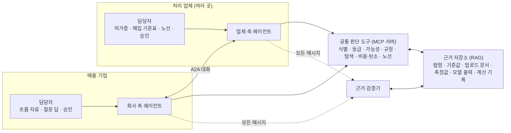
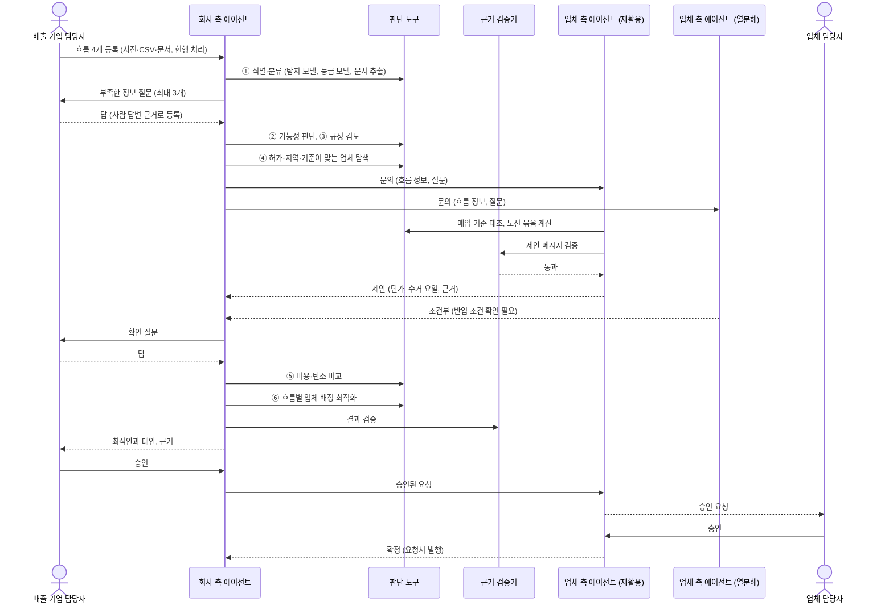
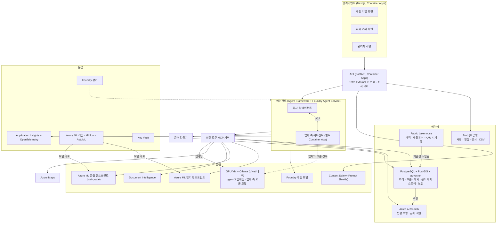

# Re:Source AI 설계안 v3

- 작성일: 2026-11-16
- 용도: 팀 검토용 설계 기준 문서
- 이전 판: [설계안 v2](ReSource_AI_설계안_v2.md) (기록으로 남긴다)
- 근거 문서: [문제 정의 v2](문제정의_v2.md)의 근거·가정, `reviews/2026-11-16_설계안_v2/consolidated_review_report.md`(설계안 v2 리뷰 결과)
- 이 문서는 설계다. 각 구성 요소가 지금 코드에 있는지는 12장 구현 상태 표에서만 밝힌다.

## 목차

1. [한 줄 정의와 핵심 문제](#1-한-줄-정의와-핵심-문제)
2. [목표, 비목표, 성공 지표](#2-목표-비목표-성공-지표)
3. [사용자](#3-사용자)
4. [서비스 흐름](#4-서비스-흐름)
5. [두 에이전트](#5-두-에이전트)
6. [대회 6단계와 화면 표시](#6-대회-6단계와-화면-표시)
7. [근거 강제: 숫자와 법 조항](#7-근거-강제-숫자와-법-조항)
8. [판단 도구](#8-판단-도구)
9. [화면](#9-화면)
10. [아키텍처와 Azure 자원](#10-아키텍처와-azure-자원)
11. [데이터 계약](#11-데이터-계약)
12. [구현 상태와 재사용](#12-구현-상태와-재사용)
13. [검토한 대안](#13-검토한-대안)
14. [리스크와 대응](#14-리스크와-대응)
15. [시연 시나리오](#15-시연-시나리오)
16. [구현 순서](#16-구현-순서)
17. [v2 대비 바뀐 점](#17-v2-대비-바뀐-점)
18. [용어](#18-용어)

---

## 1. 한 줄 정의와 핵심 문제

**한 줄 정의.** 폐기물을 내보내는 회사와 받는 처리 업체가 각자 자료를 올리면, 양쪽을 대변하는 두 에이전트가 근거를 확인하며 대화해, 흐름마다 맞는 업체와 조건과 비용을 찾아 연결한다.

**핵심 문제.** 문제가 양쪽에 있다.

- **배출 기업 쪽:** 겸직 담당자는 폐플라스틱 흐름마다 어디로 보낼 수 있는지, 그러려면 업체에 무엇을 확인해야 하는지 모른다. 확인하려면 업체마다 전화와 견적을 여러 번 주고받아야 한다. 그래서 가장 쉬운 혼합 소각을 기본값으로 둔다.
- **처리 업체 쪽:** 소량이고 혼합된 물량은 품질과 조건을 확인하는 비용이 물량의 가치보다 커서 받지 않는다.

이 서비스는 양쪽의 **조건 확인 왕복**을 두 에이전트의 대화로 대신한다. 대화에 쓰이는 숫자와 법 조항은 모두 근거 저장소에서 확인된 값만 쓴다(7장).

**검증할 가정.** 아래 가정이 틀리면 표의 오른쪽 열이 바뀐다.

| # | 가정 | 확인 방법 | 틀리면 바뀌는 곳 |
|---|---|---|---|
| H1 | 중소 사출·압출 공장에 혼합 소각되는 흐름이 실제로 있다(이미 재투입·매각되는 깨끗한 스크랩 외에) | 녹산 배출 기업 3~5곳 인터뷰 | 시연 흐름 구성, 현행 기준선 |
| H2 | 흐름을 나누면 업체의 매입 조건과 경로가 달라진다 | 재활용·열분해 업체 2~3곳 인터뷰 | 업체 매입 기준표 양식, 판단 규칙 |
| H3 | 공장이 쓰고 버린 포장재(필름·마대)가 PCR로 인정된다 | 환경부·한국환경공단 질의 | 출처 판정 결과의 표시("미확인") |
| H4 | 처리 업체가 매입 기준표와 허가증을 올릴 의향이 있다 | 업체 인터뷰: 받고 싶은 물량 조건, 공개할 수 있는 단가 범위 | 업체 온보딩 방식(직접 등록 대 대행 등록) |
| H5 | 중소 공장이 오염도·수분 같은 측정 기록을 갖고 있다 | 배출 기업 인터뷰: 검사·계량 기록 항목 | CSV 양식의 필수 열 |
| H6 | 성과 기반 수수료를 낼 의향이 있다 | 배출 기업·업체 인터뷰 | 수익 모델 |

H1~H3, H6은 문제 정의 v2 12장의 가정이다. H4, H5는 v3 구조에서 새로 생긴 가정이다.

---

## 2. 목표, 비목표, 성공 지표

### 목표

1. 배출 기업이 흐름 자료(사진·영상, 측정값 CSV, 문서)를 올리면, 흐름마다 받을 수 있는 업체와 조건, 현행 대비 월 손익을 보여 준다.
2. 처리 업체가 허가증, 매입 기준표, 수거 노선과 차량 정보를 올리면, 조건에 맞는 물량 제안을 받는다.
3. 두 에이전트의 대화와 판단 과정을 대회 6단계에 맞춰 화면에 모두 보여 준다.
4. 화면과 문서에 나오는 모든 숫자와 법 조항에 근거가 붙어 있다.
5. 양쪽 담당자가 승인하면 견적·수거 요청서와 공장 이행 계획서를 만든다.

### 비목표

- 실제 계약 체결, 실제 업체·기관 발송, 신고서 제출, 올바로시스템 연동
- 이웃 기업을 설득해 물량을 모으는 기능. 묶음은 업체 측 에이전트가 자기 노선 안에서 만든다(8.6).
- 재생원료 여권, 지원사업 신청서 작성, 현장 지식 카드, 별도의 학습 콘솔 화면. 재학습은 백그라운드 작업으로만 둔다(8.7).
- 사출 외 공정(압출, 필름)의 흐름 규칙

### 성공 지표

| 구분 | 지표 | 기준 |
|---|---|---|
| 주 지표 | 고정 사례 시험의 판정 일치율. 흐름별로 고른 업체, 경로, 확인 필요 항목이 전문가 판정과 맞는 비율 | 목표값은 사례 세트를 확정할 때 정한다. 사례는 백엔드 `pp-validation-cases.md` 10건에서 시작해 50건까지 늘린다 |
| 근거 | 근거 검증 통과율. 화면과 문서에 나온 숫자·조항 가운데 검증기를 통과한 것의 비율 | 100%. 통과하지 못한 숫자와 조항은 화면에 나오지 않는다 |
| 사용자 부담 | 배출 기업 담당자의 입력 시간, 받은 질문 수 | 질문은 최대 3개씩 2묶음(백엔드 `docs/c-track/question-policy.md`) |
| 확인 왕복 | 흐름 하나의 조건을 확정하는 데 든 에이전트 대화 턴 수와 사람 개입 횟수 | 기록만 하고 목표값은 인터뷰 뒤에 정한다 |
| 최종 시험 | 15장 시연 시나리오가 Azure 배포 주소에서 처음부터 끝까지 돈다 | 리허설 2회 연속 성공 |

---

## 3. 사용자

| 사용자 | 하는 일 | 보는 것 | 권한 |
|---|---|---|---|
| 배출 기업 담당자 | 흐름 자료를 올리고, 질문에 답하고, 결과를 승인한다 | 자기 회사의 흐름, 대화, 판단 그래프, 결과, 근거 | 자기 조직 데이터만 |
| 처리 업체 담당자 | 허가증, 매입 기준표, 노선·차량, 협상 가드레일을 올리고, 받은 제안을 승인한다 | 자기 업체로 온 문의와 대화, 자기 노선의 묶음 결과 | 자기 조직 데이터와, 문의한 배출 기업이 공개한 흐름 정보만 |
| 관리자 | 기준값 갱신, 법령 색인 갱신, 사례 시험 실행 | 전체 실행 기록 | 운영 권한 |

배출 기업끼리는 서로의 데이터를 볼 수 없다. 처리 업체는 여러 배출 기업의 물량을 자기 노선에 묶을 수 있지만, 한 배출 기업에게 다른 배출 기업의 이름이나 물량을 알려 주지 않는다.

---

## 4. 서비스 흐름

### 4.1 전체 그림



### 4.2 업체 온보딩

1. 처리 업체가 올리는 자료: 폐기물처리업 허가증(허가 품목), 매입 기준표(재질·등급·수분·형태별 매입 단가나 처리비, 최소 물량), 수거 가능 지역·요일, 차량(적재 무게와 부피), 기존 수거 노선
2. Document Intelligence가 허가증과 기준표를 구조화하고, 결과를 근거 저장소에 업체 문서 근거로 등록한다. 추출이 불확실한 값은 업체 담당자가 확인한 뒤에 등록한다.
3. 업체 담당자가 협상 가드레일을 정한다: 하한 단가, 가능 요일, 월 최소 횟수, 자동 거절 조건
4. 업체 측 에이전트 인스턴스가 이 업체 전용으로 만들어진다.

### 4.3 진단과 연결

1. 배출 기업 담당자가 흐름을 등록한다. 흐름마다 사진·영상, 측정값 CSV, 원자재 명세·MSDS·위탁 계약서, 현행 처리 방법과 단가를 넣을 수 있다.
2. 회사 측 에이전트가 ① 식별·분류를 실행한다. 부족한 정보는 흐름을 지정해 묻는다(최대 3개씩 2묶음).
3. ② 가능성 판단: 흐름마다 갈 수 있는 경로 후보와 필요한 조건을 낸다.
4. ③ 규정 검토: 경로마다 법적 요건과 위탁 업체가 갖춰야 할 허가 품목을 조항 인용과 함께 확인한다.
5. ④ 업종·기업 탐색: 허가 품목, 지역, 매입 기준이 맞는 업체 측 에이전트들을 찾아 대화를 연다.
6. 두 에이전트가 대화한다. 회사 측은 흐름 정보와 질문을 보낸다. 업체 측은 자기 매입 기준표와 노선으로 수용 여부, 조건, 단가를 답하거나, 근거를 들어 거절하거나, 확인할 것을 되묻는다.
7. ⑤ 비용·탄소 비교: 업체별 제안을 같은 기준으로 계산해 현행과 비교한다.
8. ⑥ 최적안 제안: 흐름마다 업체를 배정하는 최적안과 대안을 낸다. 양쪽 담당자가 승인하면 요청서와 이행 계획서를 만든다.

### 4.4 시퀀스



---

## 5. 두 에이전트

### 5.1 역할

| 항목 | 회사 측 에이전트 | 업체 측 에이전트 |
|---|---|---|
| 대변하는 쪽 | 배출 기업 | 처리 업체 한 곳 |
| 목적 | 흐름별 순비용 최소화, 법적 요건 충족 | 받을 수 있는 물량 확보, 노선 효율, 하한 단가 이상 |
| 쓰는 자료 | 자기 회사의 흐름, 측정값, 문서, 현행 처리 | 자기 업체의 허가증, 매입 기준표, 노선, 차량, 가드레일 |
| 맡는 단계 | ①, ②의 경로 후보, ③, ④, ⑤, ⑥ | ②의 수용 판단, ③의 허가 대조, ⑤의 운송비 산정 |
| 할 수 없는 것 | 업체 대신 단가를 정하기, 사람 승인 없이 확정하기 | 허가 품목 밖의 물량 수락, 가드레일 밖의 단가 제시, 사람 승인 없이 확정하기 |

### 5.2 인스턴스

- 에이전트 **종류**는 두 개이고, **인스턴스**는 조직마다 하나다.
- 회사 측 에이전트 하나가 업체 측 에이전트 여러 개와 동시에 대화한다. 업체별 대화는 스레드로 나눈다.
- 업체 측 에이전트 하나는 여러 배출 기업과 대화할 수 있다. 대화마다 상대 조직의 데이터만 보이게 격리한다.

### 5.3 대화 프로토콜 (A2A)

메시지 종류:

| 종류 | 뜻 |
|---|---|
| `inquiry` | 흐름 정보를 보내고 수용 여부를 묻는다 |
| `question` / `answer` | 확인할 것을 묻고 답한다 |
| `offer` / `counter` | 조건과 단가를 제시하거나 역제시한다 |
| `conditional` | 확인이 끝나면 받을 수 있다. 확인할 항목을 함께 보낸다 |
| `decline` | 받을 수 없다. 이유와 근거를 함께 보낸다 |
| `handoff` | 사람 판단이 필요하다. 가드레일 이탈, 근거 부족, 법적 판단 등 |
| `confirm` | 양쪽 사람이 승인한 뒤에만 보낸다 |

메시지 형식(요지). 본문의 숫자와 조항은 자리표시자(`{{c1}}`)로 쓰고, 값은 `claims`에서 채운다.

```json
{
  "threadId": "t-hanbit-saegil-01",
  "from": "emitter:hanbit",
  "to": "vendor:saegil",
  "type": "inquiry",
  "stage": "4",
  "streamIds": ["s2"],
  "text": "불량 성형품 월 {{c1}}을 받을 수 있는지, 라벨·금속 인서트 이물 {{c2}} 상태로도 가능한지 확인을 요청합니다.",
  "claims": [
    { "id": "c1", "kind": "quantity", "value": 400, "unit": "kg/월", "evidence": ["human:q-s2-monthly"] },
    { "id": "c2", "kind": "ratio", "value": 0.06, "unit": "면적비", "evidence": ["model:resource-ai-detector@v3:frame-hash"] }
  ]
}
```

- **턴 상한:** 스레드당 12턴. 넘으면 `handoff`
- **종료 조건:** `confirm`, `decline`, `handoff`, 또는 배출 기업 담당자의 중단
- **사람에게 넘기는 조건:** 가드레일 이탈, 근거 검증 2회 실패, 법적 판단이 "확인 필요", 업로드 문서에 지시문으로 보이는 내용이 감지됨(14장)

### 5.4 구현 방식

- 두 에이전트는 Microsoft Agent Framework로 만들고, Foundry Agent Service에 등록해 실행 추적을 남긴다.
- 판단 도구는 MCP 서버 하나로 제공하고, 두 에이전트가 같은 서버를 쓴다. 같은 입력이면 어느 쪽이 불러도 같은 결과가 나온다.
- 업체 측 에이전트는 회사 측 에이전트와 별도 서비스(Container App)로 배포하고, A2A 메시지로만 통신한다.
- 모델은 "무엇을 묻고 어떤 도구를 부를지", "도구 결과를 어떻게 설명할지"만 정한다. 숫자와 판정은 도구와 근거에서 나온다.
- 회사 측 에이전트와 문서 작성은 Foundry에 배포한 채팅 모델을 쓴다.
- 업체 측 에이전트는 업체가 모델을 고른다: Foundry 채팅 모델(기본) 또는 Ollama로 서빙하는 오픈 모델. Ollama를 고르면 업체 자료가 외부 모델 서비스로 나가지 않는다. 메시지 형식과 근거 검증 규칙은 모델과 관계없이 같다. 시연에서는 업체 한 곳을 Ollama로 돌려, 서로 다른 모델이 같은 규칙 아래 대화하는 장면을 보여 준다.

---

## 6. 대회 6단계와 화면 표시

| 대회 단계 | 맡는 쪽 | 쓰는 도구 | 남기는 근거 | 화면에 보이는 것 |
|---|---|---|---|---|
| ① 식별·분류 | 회사 측 | 탐지 모델, 등급 모델, 문서 추출, 출처 판정 | `model`, `measure`, `doc`, `human` | 흐름 카드마다 재질, 오염 등급, 출처, 탐지 박스, 등급 확률 |
| ② 가능성 판단 | 회사 측 후보, 업체 측 수용 판단 | 경로 판단(조건부), 매입 기준 대조 | `calc`, `doc`(업체 기준표) | 흐름마다 경로 후보와 상태(확정, 조건부, 확인 필요), 막힌 조건 |
| ③ 규정 검토 | 양쪽 | 조항 검색, 허가 품목 대조 | `law`, `doc`(허가증) | 경로와 업체마다 요건 체크리스트와 조항 원문 |
| ④ 업종·기업 탐색 | 회사 측 | 업체 탐색(PostGIS, 허가·지역·기준 필터) | `calc`, `doc` | 후보 업체와 걸러진 업체(이유), 열린 대화 스레드 |
| ⑤ 비용·탄소 비교 | 양쪽 | 비용·탄소 계산, 업체 노선 계산 | `calc`, `ref`(가격·배출계수·KAU) | 업체 제안별 월 손익, 운송비, 탄소, 현행 대비 |
| ⑥ 최적안 제안 | 회사 측, 양쪽 승인 | 흐름별 업체 배정 최적화, 문서 작성 | `calc`, `law`, `doc` | 최적안과 대안, 승인 상태, 요청서와 이행 계획서 |

- 화면 위쪽에 **6단계 진행 막대**를 항상 둔다. 단계마다 상태(대기, 진행, 완료, 확인 필요)를 표시한다.
- 단계를 누르면 대화와 판단 그래프가 그 단계의 메시지와 노드만 보이게 걸러진다.
- 에이전트 메시지와 도구 호출은 모두 `stage` 값을 가진다. 그래서 어느 단계의 일인지 화면에서 바로 보인다.

---

## 7. 근거 강제: 숫자와 법 조항

### 7.1 원칙

1. 화면, 대화, 문서에 나오는 **모든 숫자와 법 조항은 근거 저장소의 근거 ID에 연결된다.** 연결되지 않은 숫자와 조항은 내보내지 않는다.
2. **모델은 숫자를 만들지 않는다.** 숫자는 근거 레코드나 판단 도구의 계산 기록에서만 온다. 모델은 자리표시자와 근거 ID를 고른다.
3. **법 조항은 색인된 원문에서만 인용한다.** 인용문은 원문의 일부와 글자 그대로 일치해야 한다.
4. **근거가 없으면 "확인 필요"로 표시하고 묻는다.** 팀이 정한 가정값을 쓸 때도 가정값 자체를 근거 레코드로 등록하고 화면에 "가정값"으로 표시한다.

### 7.2 근거 저장소

| 근거 종류 | ID 형식 | 내용 | 원천 |
|---|---|---|---|
| `law` | `law:<법령ID>:<조>:<항>:<호>@<시행일>` | 법령, 시행규칙, 고시, 지침의 조항 원문 | 국가법령정보센터 Open API, 지침·공고 원문 PDF |
| `ref` | `ref:<데이터셋>:<항목>:<지역>@<기준월>` | 가격조사 단가, 배출계수, KAU 시세, 공개 처리 단가 | 공공데이터포털, 온실가스종합정보센터, 한국거래소. Fabric Lakehouse에 시계열로 적재하고 기준월 스냅숏을 등록 |
| `doc` | `doc:<조직>:<문서ID>#p<쪽>` | 업로드 문서에서 추출한 값과 원문 위치 | 업체 허가증·매입 기준표, 배출 기업 원자재 명세·MSDS·위탁 계약서 |
| `measure` | `measure:<조직>:<파일ID>#r<행>` | CSV 측정값 | 배출 기업 CSV |
| `model` | `model:<모델명>@<버전>:<입력해시>` | 탐지, 등급 모델 출력 | Azure ML 엔드포인트 |
| `human` | `human:<질문ID>` | 질문에 대한 사람의 답 | 화면 입력 |
| `calc` | `calc:<도구호출ID>` | 판단 도구의 계산 결과와 입력 근거 ID 목록 | 판단 도구 |
| `assumption` | `assumption:<항목>@<버전>` | 팀이 정한 가정값과 그 이유 | 저장소의 기준값 파일 |

- 정본은 PostgreSQL의 근거 레지스트리다. 근거 ID, 종류, 값, 단위, 원문 발췌, 출처, 기준일, 접근 조직, 버전을 담는다.
- 검색은 Azure AI Search 색인으로 한다. 법령 조항과 근거 레코드를 하이브리드 검색과 시맨틱 랭커로 찾고, 결과는 근거 ID로 돌려준다.
- 벡터는 Ollama로 서빙하는 bge-m3 임베딩 모델로 만든다(교육 2일차와 같은 모델). 색인할 때 미리 계산한 벡터를 AI Search에 넣고, 질의 벡터도 같은 모델로 만든다. 임베딩 모델을 바꾸면 색인 전체를 다시 만든다.
- 조직 문서와 측정값은 색인 단계에서 조직 필터를 걸어, 다른 조직의 근거가 검색되지 않게 한다.
- `calc` 근거는 입력 근거 ID 목록을 갖는다. 그래서 화면에서 계산 결과를 누르면 근거 사슬을 끝까지 따라갈 수 있다.

### 7.3 강제 방식 (세 겹)

1. **출력 형식 제약.** 에이전트의 모든 메시지와 문서 초안은 JSON 스키마로 받는다. 본문의 숫자와 조항 자리는 자리표시자로 두고, `claims`에 값과 근거 ID를 넣는다. 화면은 본문을 그릴 때 `claims` 값만 채워 넣는다.
2. **근거 검증기(코드).** 메시지가 상대 에이전트나 화면으로 나가기 전에 검증한다.
   - 본문에 자리표시자 밖의 숫자가 있으면 거부한다. 날짜와 식별자처럼 정해 둔 형식은 예외다.
   - 모든 claim의 근거 ID가 레지스트리에 있고, 보내는 조직이 접근할 수 있는지 확인한다.
   - claim 값이 근거 값과 같은지 확인한다. 단위가 다르면 정해진 환산표로 바꿔 비교한다. 계산 값은 `calc` 기록과 같아야 한다.
   - 기준일을 확인한다. 가격은 기준월이 정해진 기간 안이어야 하고, 법령은 시행 중이어야 한다.
   - 법 조항 claim은 인용문이 해당 조항 원문의 부분 문자열인지 확인한다.
   - 실패하면 메시지를 거부하고, 실패 이유를 붙여 에이전트에게 다시 쓰게 한다(최대 2회). 그래도 실패하면 `handoff`로 바꾸고, 화면에 "근거 확인 실패"를 표시한다.
3. **사후 평가.** Foundry 평가로 근거 충실도(groundedness)를 재고, 고정 사례 시험에서 검증기 통과율과 판정 일치율을 함께 기록한다.

### 7.4 화면 표시

- 숫자와 조항은 근거가 있다는 표시와 함께 나온다. 누르면 근거 패널이 열린다: 원문 발췌, 출처, 기준일, 버전, 계산 사슬
- 가정값은 "가정값" 라벨을 붙이고, 그 가정이 쓰인 계산 결과에도 같은 라벨이 이어진다.
- 근거 확인에 실패한 메시지는 내용 대신 실패 사실과 사람에게 넘긴 상태를 보여 준다.

---

## 8. 판단 도구

모두 결정적 함수로 만들고, MCP 서버 하나로 두 에이전트에 제공한다. 호출마다 `calc` 근거를 남긴다.

### 8.1 입력 두 경로와 오염 등급

| 경로 | 처리 | 결과 |
|---|---|---|
| 사진·영상 | Azure ML 탐지 엔드포인트(RT-DETR 재질·상태 모델, 영상은 ByteTrack) | 재질, 이물 박스, 면적 기준 오염 비율 |
| 측정값 CSV | 검증 후 저장, Azure ML 등급 엔드포인트(`rsai-grade`, AutoML로 학습한 표 데이터 분류 모델) | 행마다 등급과 확률, 흐름별 등급 분포 |

- 측정값이 있으면 측정값 등급을 우선한다. 없으면 사진에서 추정한 오염 비율과 질문으로 받은 수분을 같은 등급 모델에 넣고 "사진 추정"으로 표시한다. 두 결과가 다르면 확인 질문을 하나 낸다.
- 등급 A·B·C의 기준(재질별 오염도·수분 상한)은 기준값 파일로 관리한다. 업체 매입 기준표가 있으면 그 업체와의 대화에서는 업체 기준을 우선한다.
- 문서(원자재 명세, MSDS, 위탁 계약서)는 Document Intelligence로 수지 종류, 등급, 현행 처리 단가를 추출한다.
- 출처(PIR·PCR)는 공정명과 입고 기록으로 판정하고, 애매하면 묻는다. PCR 인정 여부는 H3가 확인되기 전까지 "미확인"으로 표시한다.

### 8.2 경로 판단 (②)

- 흐름마다 경로 후보(재투입, 매각, 열분해, 소각)와 상태를 낸다: `calculated`(확정), `conditional`(조건부), `needs_information`(확인 필요)
- 조건부일 때는 "확인할 것" 목록을 낸다. 이 목록이 업체 측 에이전트에게 보낼 질문이 된다.
- 최소 물량과 적재 검사는 출처와 관계없이 모든 외부 반출 경로에 똑같이 적용한다. 같은 업체로 가는 같은 공장의 흐름은 먼저 합쳐서 계산한다.
- 현행 경로와 단가는 입력으로 받는다. 입력이 없으면 "혼합 소각"을 가정값으로 쓰고, 현행 상태에 따른 민감도를 함께 낸다.

### 8.3 매입 기준 대조 (업체 측 ②)

업체 매입 기준표의 재질, 등급, 수분, 형태, 최소 물량 조건을 흐름 정보와 대조해 수용, 조건부, 거절 중 하나를 낸다. 결과마다 기준표의 근거 ID를 붙인다.

### 8.4 규정 (③)

- 경로마다 필요한 요건을 조항 검색으로 찾는다: 위탁 업체 허가 품목, 순환자원 인정 요건, 공동 처리 요건 등
- 업체 허가증의 허가 품목과 흐름 품목을 대조한다. 허가 품목이 맞지 않는 업체와는 대화를 열지 않거나, 연 대화를 `decline`으로 닫는다.

### 8.5 업체 탐색 (④)

PostGIS로 지역, 허가 품목, 매입 기준이 맞는 업체를 찾는다. 걸러진 업체는 이유를 근거와 함께 남긴다.

### 8.6 비용 최적화 (⑤, ⑥)

- **회사 측 목적:** 흐름별 월 순비용 합계를 최소화한다. 순비용은 처리비에서 매각 수익을 빼고, 운반비와 전처리 인건비를 더한 값이다. 제약은 허가 품목, 매입 기준, 최소 물량, 업체 처리 용량이다. 흐름과 업체의 배정 문제는 OR-Tools(CP-SAT)로 푼다.
- **업체 측 노선 묶음:** 업체는 새 물량을 자기 기존 노선에 넣었을 때의 추가 운송비를 OR-Tools(CVRP, 무게와 부피 제약)로 계산하고, 이를 근거로 단가를 제시한다. 여러 배출 기업의 물량을 한 노선에 묶는 일은 업체 측 에이전트 안에서만 일어난다. 배출 기업에게는 결과 단가와 수거 일정만 보인다.
- **거리:** Azure Maps 도로 거리를 쓴다. 한국 도로 경로 지원은 구현 첫 단계에서 실제 호출로 확인한다(14장).
- **협상:** 단가는 양쪽 가드레일 안에서만 오간다. 제안마다 비용 계산을 다시 해서 `calc` 근거로 남긴다.
- **탄소:** 경로별 배출계수로 계산해 함께 보여 준다. 기본 목적 함수에는 넣지 않고, 담당자가 탄소 가중치를 켜면 목적 함수에 더한다.

### 8.7 재학습 (백그라운드)

- 사람이 고친 박스, 재질, 출처는 탐지 모델 재학습 데이터가 된다.
- 업체가 확정 뒤에 기록한 실제 등급과 단가는 등급 모델 학습 데이터와 기준값 보정에 쓴다.
- 재학습, 모델 비교, 배포 게이트는 Azure ML 작업과 MLflow로 돌리고, 결과는 관리자 화면의 표 하나로 확인한다.

---

## 9. 화면

화면 규칙은 [DESIGN.md](../DESIGN.md)를 따른다. 대화 타임라인과 판단 그래프는 DESIGN.md에 아직 규칙이 없으므로, DESIGN.md 개정안을 따로 올려 승인받은 뒤 구현한다.

### 9.1 진단·연결 화면 (메인)

```
┌───────────────────────────────────────────────────────────────┐
│ ① 식별·분류 ✓ │ ② 가능성 ✓ │ ③ 규정 ⚠ │ ④ 탐색 ● │ ⑤ 비용 ○ │ ⑥ 최적안 ○ │
├──────────────────────────┬────────────────────────────────────┤
│ 대화 타임라인             │ 판단 그래프                         │
│ [새길자원] [남해열분해] … │  흐름 ─ 기준 ─ 업체                  │
│ 회사 측 ▸ 문의 …  (근거)  │  (충족 / 조건부 / 불충족 / 근거)      │
│ 업체 측 ◂ 조건부 … (근거) │                                     │
├──────────────────────────┴────────────────────────────────────┤
│ 결과 한 장: 흐름별 배정 업체 · 경로 · 단가 · 월 손익(현행 대비) · 탄소 │
└───────────────────────────────────────────────────────────────┘
```

- **6단계 진행 막대(위):** 단계별 상태를 보여 주고, 누르면 그 단계만 걸러 보여 준다.
- **대화 타임라인(왼쪽):** 업체별 스레드 탭, 메시지 종류 표시(문의, 질문, 제안, 조건부, 거절, 사람 넘김), 메시지 안의 숫자와 조항 근거 표시, 검증기 통과 여부
- **판단 그래프(오른쪽)**
  - 노드: 흐름, 판단 기준(허가 품목, 매입 기준, 최소 물량, 규정 요건, 비용), 업체, 근거 문서
  - 엣지: 충족, 조건부, 불충족
  - 노드를 누르면 근거 패널이 열린다.
  - 대화가 진행되면 엣지 상태가 실시간으로 바뀐다.
- **결과 한 장(아래):** 흐름별로 배정된 업체, 경로, 단가, 월 손익과 현행 대비 차이, 탄소, 가정값 여부. 대안 배정도 함께 보여 준다.

### 9.2 자료 올리기

- **배출 기업:** 흐름 카드 목록. 카드마다 "사진·영상", "측정값 CSV", "문서" 탭과 현행 처리 입력이 있다. CSV 양식을 내려받을 수 있다.
- **처리 업체:** 허가증, 매입 기준표, 노선·차량, 가드레일. 추출된 값을 확인하는 화면이 있다.

### 9.3 승인

- 양쪽 담당자가 각자 화면에서 승인한다. 승인 전에 근거가 확인 실패인 항목이 있으면 승인 버튼이 꺼진다.
- 승인 뒤에 견적·수거 요청서와 공장 이행 계획서를 만든다. 문서 안의 숫자와 조항도 7장 규칙을 따른다.

### 9.4 근거 패널

원문 발췌, 출처 링크, 기준일, 버전, 계산 사슬(입력 근거까지)을 보여 준다. 법 조항은 조문 원문을 그대로 보여 준다.

---

## 10. 아키텍처와 Azure 자원

### 10.1 구성



### 10.2 Azure 자원과 쓰임

| 자원 | 쓰임 | 비고 |
|---|---|---|
| Foundry(AI Services) + 채팅 모델 배포 | 두 에이전트의 대화, 문서 문장 작성 | 숫자와 조항은 만들지 않는다 |
| Foundry Agent Service | 두 에이전트 등록과 실행 추적 | |
| Foundry 평가 | 근거 충실도, 사례 시험 | |
| Azure AI Search | 법령 조항과 근거 레코드 검색(하이브리드 + 시맨틱 랭커) | Basic 이상 |
| Azure AI Document Intelligence | 허가증, 매입 기준표, 원자재 명세, MSDS, 위탁 계약서 추출 | |
| Azure AI Content Safety (Prompt Shields) | 업로드 문서와 메시지의 지시문 주입 감지 | |
| Azure GPU 가상 머신 + Ollama | bge-m3 임베딩 서빙, 업체 측 에이전트용 오픈 모델 서빙 | VNet 안에서만 접근하고 11434 포트를 인터넷에 열지 않는다(교육 때 SSH 터널을 쓴 이유와 같다). T4급 소형 GPU SKU로 시작하고, 쓰지 않을 때는 할당 해제한다 |
| Azure Machine Learning | 탐지 모델 학습·등록·엔드포인트, 등급 모델 AutoML 학습·등록·엔드포인트, MLflow | 엔드포인트는 시연 외에는 내려 둔다 |
| Microsoft Fabric Lakehouse | 기준값 시계열 적재와 기준월 스냅숏 | 테넌트 권한 확인 필요 |
| Azure Database for PostgreSQL | 근거 레지스트리, 조직, 흐름, 대화, 노선, PostGIS, pgvector | |
| Azure Maps | 도로 거리 | 한국 경로 지원 확인 필요 |
| Blob Storage | 업로드 원본 | 비공개 |
| Container Apps, Container Registry | API, 프런트, 업체 측 에이전트, MCP 서버 | 최소 복제본 0 |
| Application Insights, Log Analytics | 실행 추적, 대화 기록 재생 | |
| Key Vault | 비밀, 키 | |
| Entra External ID | 배출 기업, 업체, 관리자 로그인과 역할 | |

리소스 생성, 비용, 권한 확인 절차는 개발 지시(`prompts/`)에 따른다. 대회 기간의 Azure 구독, 예산, 권한은 아직 확인되지 않았다.

---

## 11. 데이터 계약

필드의 정본은 코드(백엔드 스키마, 프런트 타입)다. 이 표는 객체와 만드는 쪽만 정한다.

| 객체 | 주요 내용 | 만드는 쪽 |
|---|---|---|
| Organization | 조직 종류(배출 기업, 처리 업체), 위치, 소속 단지 | 사용자 |
| VendorProfile | 허가 품목, 매입 기준표, 수거 지역·요일, 차량, 노선, 가드레일 | 업체 담당자 + 문서 추출 |
| Stream | 흐름 이름, 공정, 현행 경로와 단가, 월 발생량, 입력 자료 | 배출 기업 담당자 |
| Measurement | CSV 행(오염도, 수분, 형태, 측정일) | 배출 기업 담당자 |
| Classification | 재질, 출처, 탐지 결과, 오염 등급(`grade`, `probabilities`, `source`, 모델 버전) | ① |
| RouteCandidate | 경로, 상태(확정, 조건부, 확인 필요), 확인할 것 | ② |
| RegulationCheck | 요건, 상태, 조항 근거 | ③ |
| VendorCandidate | 후보 업체, 걸러진 이유 | ④ |
| Thread, AgentMessage | 스레드, 메시지 종류, 단계, 본문, claims, 검증 결과 | 두 에이전트, 검증기 |
| Claim | 값, 단위, 종류, 근거 ID 목록 | 에이전트 + 도구 |
| Evidence | 7.2의 근거 레코드 | 수집 파이프라인, 도구, 사람 |
| Offer | 단가, 일정, 조건, 계산 근거 | 업체 측 |
| CostResult | 배정안별 흐름 내역, 월 손익, 현행 대비, 탄소, 가정값 목록 | ⑤ |
| Assignment | 흐름별 배정 업체와 대안 | ⑥ |
| Approval | 양쪽 승인 기록 | 담당자 |
| Document | 요청서, 이행 계획서 | ⑥ |
| Outcome | 확정 후 실제 등급, 단가, 수량 | 업체 담당자 |
| RunEvent | 단계, 도구 호출, 소요 시간, 근거 ID | 추적 |

---

## 12. 구현 상태와 재사용

2026-11-16 기준이다(구현을 시작하기 전). 상태 값: main(병합됨), 미병합(원격 브랜치에만 있음), 없음. 구현한 뒤의 실제 상태는 [설계안 v3 구현 상태](ReSource_AI_설계안_v3_구현_상태.md)를 따른다.

| 구성 요소 | 상태 | 위치와 재사용 방법 |
|---|---|---|
| 탐지 모델(RT-DETRv2 재질·상태) | 로컬 학습 완료, 백엔드 추론 main | 비전 저장소 `ml/`, 백엔드 `app/ml/`. Azure ML 작업과 엔드포인트로 옮긴다 |
| 등급 모델(CSV) | 없음 | 교육 1일차 방식으로 새로 만든다 |
| 조건부 경로 판정 계약 | main | 백엔드 `StreamDecision`(status, nullable route) |
| 경로 규칙, 비용 계산 | main, 미병합 | 백엔드 `demo_routes.py`, `economics_adapter.py`, `feat/16-cost-carbon` |
| 질문 선택(최대 3개 × 2묶음) | main | 백엔드 `pp_question_selector.py`, `docs/c-track/question-policy.md` |
| 고정 사례 10건 | main(문서) | 백엔드 `docs/c-track/pp-validation-cases.md`. 테스트로 만든다 |
| PostGIS, OR-Tools, Azure Maps, A2A 어댑터, 단계 실행기 | 미병합 | 백엔드 `origin/feat/track-d-platform`. 업체 노선 계산과 A2A로 다시 쓴다 |
| 규정 항목(법령 인용) | 프런트 모의 | `pipeline.ts`의 고정 문자열. 법령 색인으로 대체한다 |
| 근거 저장소, 근거 검증기 | 없음 | 새로 만든다 |
| Ollama 서빙(bge-m3, 오픈 모델) | 없음 | 교육 2일차 실습(GPU VM, Ollama 설치, bge-m3)을 출발점으로 쓴다. 미니 프로젝트 `tools.py`의 `OllamaEmbeddings` 사용법을 참고한다 |
| 두 에이전트, MCP 서버 | 없음 | 새로 만든다 |
| 대화 타임라인, 판단 그래프 화면 | 없음 | 새로 만든다. 협상 장부·실행 콘솔의 화면 규칙(DESIGN.md)을 출발점으로 쓴다 |
| 로그인(Entra External ID) | main | 프런트 `src/auth.ts`. 역할을 추가한다 |
| Azure 배포 | 없음 | Bicep, Container Apps 배포를 새로 만든다 |

---

## 13. 검토한 대안

| 결정 | 고른 것 | 검토한 대안 | 고른 이유 |
|---|---|---|---|
| 에이전트 구성 | 양쪽을 대변하는 오케스트레이션 에이전트 두 종류 | v2의 단계별 에이전트 6개 + 조정 에이전트 | 6개 중 3개(②④⑤)는 결정적 계산이라 에이전트로 나눌 이유가 없었다. 실제 이해관계가 갈리는 곳은 배출 기업과 처리 업체 사이다. 6단계는 도구와 화면으로 보인다 |
| 업체 측 구성 | 업체마다 인스턴스 | 모든 업체를 대변하는 시장 에이전트 하나 | 한 에이전트가 경쟁 업체들을 함께 대변하면 업체별 가드레일과 이해가 섞인다. 업체별 인스턴스라야 비교와 협상이 성립한다 |
| 숫자·조항 처리 | 근거 저장소 + 자리표시자 + 검증기 | 프롬프트로 "근거를 인용하라"고 지시 | 지시만으로는 지어낸 숫자를 막을 수 없다. 코드 검증만이 "근거 100%"를 보장한다 |
| 판단 위치 | 공통 판단 도구(MCP) | 각 에이전트가 직접 계산 | 같은 입력에 같은 결과가 나와야 양쪽이 결과를 믿는다. MCP로 두면 두 에이전트가 같은 도구를 쓴다 |
| 묶음 수거 | 업체 측 노선 묶음 | v2의 이웃 기업 설득과 동의 | 이웃 기업의 물량 데이터를 얻을 방법이 없었고, 분담 비율로 물량이 역산됐다. 노선은 업체가 이미 가진 정보다 |
| 모델 서빙 | Foundry 채팅 모델(회사 측, 문서) + Ollama(임베딩, 업체 측 선택지) | Foundry만 사용, 또는 Ollama만 사용 | 한국어 법령 검색에는 bge-m3가 맞고, 업체 자료를 외부 모델에 보내지 않는 선택지가 업체 참여(H4)에 도움이 된다. 에이전트의 기본 모델까지 Ollama로 바꾸면 GPU 비용과 응답 형식 안정성에서 손해라 기본값은 Foundry로 둔다 |
| 규정 검색 | Azure AI Search 조항 색인 | 정해 둔 조항 표만 사용 | 업체 허가 품목, 흐름 종류에 따라 필요한 조항이 달라 검색이 필요하다. 검증은 레지스트리 원문으로 한다 |
| 기준값 저장 | Fabric 시계열 → PostgreSQL 기준월 스냅숏 | PostgreSQL만 사용 | 가격과 계수의 시계열 관리는 Fabric에서, 근거 ID와 검증은 레지스트리에서 한다. Fabric 권한이 없으면 수집 파이프라인만 PostgreSQL로 옮긴다(14장) |

---

## 14. 리스크와 대응

| 분류 | 리스크 | 대응 |
|---|---|---|
| 시장 | 업체가 기준표를 올리지 않음(H4) | 시연은 가상 업체 프로필로 한다. 공개 허가 업체 목록으로 대행 등록 초안을 만들고 업체가 확인하는 방식을 함께 둔다 |
| 시장 | 업체가 단가를 공개하지 않음 | 기준표에 단가 대신 범위나 "문의"를 허용한다. 그 흐름은 조건부로 두고 대화에서 확인한다 |
| 데이터 | 측정 기록이 없음(H5) | 사진 추정 경로로 대신하고 "사진 추정"으로 표시한다 |
| 데이터 | 등급 모델이 합성 데이터로만 학습됨 | 점수에 "합성 데이터 기준"을 표시한다. 실제 등급이 쌓이기 전에는 배포 게이트를 통과시키지 않는다 |
| 근거 | 근거가 없는 값이 많아 "확인 필요"가 늘어남 | 가정값을 근거 레코드로 등록해 쓰되 라벨을 붙인다. 인터뷰 결과로 가정값을 바꾼다 |
| 근거 | 법령 원문 수집 실패 | 원문을 확인하지 못한 조항은 색인하지 않는다. 해당 요건은 "확인 필요"로 둔다 |
| 대화 | 에이전트 대화가 길어져 비용과 시간이 늘어남 | 스레드당 12턴 상한, 판정은 도구가 하고 모델은 짧은 메시지만 쓴다 |
| 법적 책임 | 에이전트 합의가 계약으로 오해됨 | 양쪽 사람 승인 전에는 "확정"이라는 말을 쓰지 않는다. 문서는 "요청서"와 "계획서"로만 만든다 |
| 보안 | 업로드 문서를 통한 지시문 주입 | 문서 내용은 근거로만 쓰고 지시로 해석하지 않는다. Prompt Shields로 감지되면 `handoff` |
| 보안 | 조직 사이 데이터 노출 | 근거 색인과 레지스트리에 조직 필터를 건다. 업체는 묶음 결과를 다른 배출 기업에게 알리지 않는다 |
| 보안 | 국내 기업 자료의 해외 지역 저장 | 쓸 지역과 데이터 위치를 문서에 적는다. 정책이 허용하면 한국 지역을 쓴다 |
| Azure | 구독, 권한, 할당량, 예산 미확인 | 개발 첫 단계에서 확인하고, 만들 수 없는 자원은 보고해 결정을 받는다 |
| Azure | GPU 할당량이 없거나 GPU VM 비용이 큼 | T4급 소형 SKU로 시작하고 쓰지 않을 때 할당 해제한다. 할당량이 없으면 임베딩은 Foundry 임베딩 모델로 바꾸고, 업체 측 오픈 모델 선택지는 뺀다(팀 결정) |
| 모델 | 오픈 모델이 메시지 형식(JSON, 자리표시자)을 잘 지키지 못함 | 근거 검증기가 거부하고 다시 쓰게 한다. 2회 실패하면 `handoff`로 넘긴다. 시연 전에 사례 시험으로 통과율을 확인하고, 낮으면 그 업체를 Foundry 모델로 돌린다 |
| Azure | Fabric 테넌트 권한이 없음 | 기준값 수집 파이프라인을 PostgreSQL로 옮긴다(13장) |
| Azure | Azure Maps가 한국 도로 경로를 지원하지 않음 | 실제 호출로 먼저 확인한다. 안 되면 다른 경로 API를 쓸지 팀이 정한다 |
| 대회 | 6단계가 보이지 않는다는 평가 | 6단계 진행 막대, 단계별 필터, 메시지마다 단계 표시(6장) |
| 대회 | 공지 원문(심사 기준, 마감) 미확인 | 원문을 받는 대로 2장 지표와 16장 순서를 조정한다 |

---

## 15. 시연 시나리오

**등장 조직(모두 가상).**

| 조직 | 종류 | 설정 |
|---|---|---|
| (주)한빛정밀 | 배출 기업 | 녹산산단 PP 사출 공장. 흐름 네 개: 스프루·러너(PP, PIR), 불량 성형품(PP, 라벨·금속 인서트, PIR), 퍼지·색 혼합(PP+ABS, PIR), 원자재 포장 필름(LDPE, PCR). 현행 처리는 담당자가 입력한다 |
| (주)새길자원 | 처리 업체(재활용) | 폐합성수지 허가, PP·PE 매입 기준표, 녹산 순회 노선 보유 |
| (주)남해열분해 | 처리 업체(열분해) | 김해, 혼합 폴리올레핀 반입 조건 |
| (주)미소환경 | 처리 업체 | 폐합성수지 필름 허가 품목 없음 |

**장면 순서와 6단계.**

1. 한빛정밀 담당자가 흐름 네 개를 올린다. 불량 성형품은 사진, 스프루와 퍼지는 측정값 CSV, 필름은 사진과 입고 기록이다. → ① 진행 막대가 켜지고, 흐름 카드에 재질, 등급, 출처가 근거와 함께 나온다.
2. 회사 측 에이전트가 현행 처리와 월 발생량을 묻는다(질문 한 묶음). → ② 흐름별 경로 후보와 상태가 그래프에 나타난다.
3. ③ 규정 요건과 허가 품목이 조항 원문과 함께 체크된다.
4. ④ 후보 업체가 그래프에 켜진다. 미소환경은 필름 허가 품목이 없어 회색으로 걸러지고, 이유와 근거가 남는다.
5. 대화가 열린다. 새길자원 측 에이전트는 필름이 자기 녹산 노선에 들어간다는 계산 근거와 함께 단가를 제시한다. 남해열분해 측 에이전트는 ABS 혼입 비율 확인이 필요하다며 조건부로 답한다. 회사 측 에이전트가 담당자에게 묻고, 답을 받아 다시 보낸다.
6. ⑤ 업체 제안별 월 손익과 탄소가 현행과 비교된다. 숫자는 모두 근거 패널로 열 수 있다.
7. ⑥ 흐름별 배정 최적안과 대안이 나온다. 양쪽 담당자가 승인하면 요청서와 이행 계획서가 만들어진다.

**숫자.** 이 문서는 시연 숫자를 미리 정하지 않는다. 숫자는 근거 저장소의 기준값과 가정값, 업체 기준표로 판단 도구가 계산한 결과다. 가정값을 바꾸면 결과도 바뀐다. 현행 상태에 따른 민감도(예: 스프루를 이미 재투입하는 경우)를 결과 한 장에 함께 보여 준다.

---

## 16. 구현 순서

각 단계는 Azure 배포 주소에서 확인한다. 세부 지시는 `prompts/`의 개발 지시를 따른다.

1. Azure 환경 조사, 리소스 계획 승인, 인프라와 첫 배포
2. **근거 저장소와 근거 검증기를 먼저 만든다.** 나머지 기능이 모두 이것에 기대기 때문이다. 법령 색인, 기준값 스냅숏, 근거 레지스트리, 자리표시자 렌더링을 포함한다.
3. 입력 두 경로: 탐지 엔드포인트, CSV와 등급 엔드포인트, 문서 추출
4. 판단 도구 MCP 서버: ②~⑥ 계산, 업체 노선 계산, 고정 사례 시험
5. 두 에이전트와 A2A 대화, 가드레일, 사람 넘김
6. 화면: 6단계 진행 막대, 대화 타임라인, 판단 그래프, 결과 한 장, 근거 패널, 자료 올리기, 승인. DESIGN.md 개정안 승인 후에 구현한다.
7. 평가(사례 시험, Foundry 평가), 시연 데이터와 리허설

마감일은 대회 공지를 확인한 뒤 이 순서에 날짜를 붙인다.

---

## 17. v2 대비 바뀐 점

| 항목 | v2 | v3 |
|---|---|---|
| 에이전트 | 조정 에이전트 + 단계별 6개 | 배출 기업과 처리 업체를 대변하는 두 종류. 조직마다 인스턴스 |
| 6단계 | 에이전트 6개로 구현 | 두 에이전트가 쓰는 도구. 화면에 진행 막대와 단계별 필터로 표시 |
| 처리 업체 | 결과를 기록하는 쪽 | 자료를 올리고 자기 에이전트로 협상하는 사용자 |
| 묶음 수거 | 이웃 기업 동의, 적재율 게이지 | 업체 측 노선 묶음. 다른 배출 기업 정보는 보이지 않음 |
| 숫자와 법 조항 | 프런트 고정값, "인용을 강제한다"는 서술 | 근거 저장소, 근거 ID, 자리표시자, 코드 검증기 |
| 모델 서빙 | Azure OpenAI(Foundry)만 | Foundry + Ollama(bge-m3 임베딩, 업체 측 오픈 모델 선택지) |
| 입력 | 사진·영상, 원자재 명세 | 사진·영상 + 측정값 CSV(등급 모델) + 문서 |
| 경로 판정 | 확정 경로와 금액 | 확정, 조건부, 확인 필요. 현행 기준선 입력 |
| 화면 | 단계별 화면 10개 + 공용 화면 5개 | 진단·연결 화면 하나(진행 막대, 대화, 그래프, 결과) + 자료 올리기 + 승인 |
| 뺀 것 | | 이웃 기업 화면, 재생원료 여권, 지원사업 신청서, 공동처리 신고서, 현장 지식 카드, 학습 콘솔 화면, 걸으며 진단, 명령창 |

---

## 18. 용어

| 용어 | 뜻 |
|---|---|
| 흐름(Stream) | 같은 공정에서 같은 성질로 나오는 폐플라스틱 한 갈래. 공정과 재질이 다르면 다른 흐름이다 |
| 회사 측 에이전트 | 배출 기업 하나를 대변하는 오케스트레이션 에이전트 |
| 업체 측 에이전트 | 처리 업체 하나를 대변하는 오케스트레이션 에이전트 |
| 판단 도구 | 두 에이전트가 함께 쓰는 결정적 계산 함수 묶음(MCP 서버) |
| 근거(Evidence) | 숫자나 조항의 출처가 되는 레코드. 7.2의 여덟 종류 |
| 주장(Claim) | 메시지나 문서 안의 숫자·조항 하나와 그 근거 ID 목록 |
| 근거 검증기 | 메시지와 문서가 나가기 전에 모든 주장의 근거를 확인하는 코드 |
| 조건부 | 확인할 것이 남아 있어 확정할 수 없는 판정 상태 |
| 가정값 | 팀이 정한 값. 근거 레코드로 등록하고 화면에 "가정값"으로 표시한다 |
| PIR / PCR | 공정 부산물(Post-Industrial) / 사용 후 폐기물(Post-Consumer) |
| 가드레일 | 에이전트가 넘을 수 없도록 사람이 정한 범위(하한 단가, 가능 요일 등) |

---

## 19. 제품화 결정 (2026-11-18)

시연용 화면을 실제로 쓰는 제품으로 바꾸면서 정한 것이다. 화면 규칙은 DESIGN.md를 따른다.

| 항목 | 결정 | 이유와 영향 |
|---|---|---|
| 로그인 | 이메일·비밀번호로 가입한다. 계정과 회사는 DB에 저장하고, 사용자는 자기가 속한 회사의 데이터만 본다. 동료는 초대 링크로 들인다 | Entra External ID는 테넌트 관리 권한이 없어 만들 수 없다. 외부 키 없이 바로 쓸 수 있다 |
| 체험하기 | 로그인·가입 화면 아래와 소개 화면에 "체험하기"를 둔다. 시연 회사(한빛정밀)의 완성된 찾기를 읽기 전용으로 보여 준다 | 가입 전에 무엇을 하는 서비스인지 보여 준다. 시연 데이터와 실제 회사 데이터를 섞지 않는다 |
| 첫 화면 | 가입하면 배출 기업 또는 처리 업체로 자기 회사를 만들고 빈 상태에서 시작한다 | 배출 기업은 폐기물 등록, 처리 업체는 허가증·매입 기준표 올리기가 첫 행동이다 |
| 처리 업체 | 업체도 가입해 허가증, 매입 기준표, 노선을 올리고, 받은 문의와 대화를 보고 승인한다. 배출 기업의 찾기는 시연 업체와 가입한 업체를 함께 후보로 본다 | 5장 두 에이전트 구조를 실제 사용자로 채운다 |
| 화면과 백엔드의 경계 | 브라우저는 프런트 서버만 부르고, 프런트 서버가 서비스 키와 사용자·회사 ID를 붙여 백엔드를 부른다(`V3_AUTH=bff`). 체험하기는 읽기 요청만 지나간다 | 키가 브라우저에 가지 않는다. 회사 경계를 백엔드가 다시 확인한다 |
| AI 모델 | Foundry gpt-5-mini로 대화한다. 근거 검증기는 그대로 두고, 모델이 자리표시자와 허용된 메시지 종류를 지키도록 출력 형식과 프롬프트를 고친다. 통과하지 못한 메시지는 지금처럼 담당자 확인으로 넘긴다 | 2026-11-18 시험에서 초안 다수가 검증기에 거부됐다. 모델 이름과 구현 상태는 운영 화면에만 보인다 |
| 문구 | 개발자에게만 의미 있는 말(환경 변수, 서비스 이름, "연결되지 않았습니다", "예시 데이터")을 사용자 화면에 쓰지 않는다 | DESIGN.md "제품 문구 원칙" |
| 배포 | Central US의 VM 한 대에 Docker Compose로 띄운다(backend `infra/vm/`) | App Service 할당량 0, Container Apps 공급자 미등록. DB와 같은 지역이라 DB 왕복 0.9ms |
