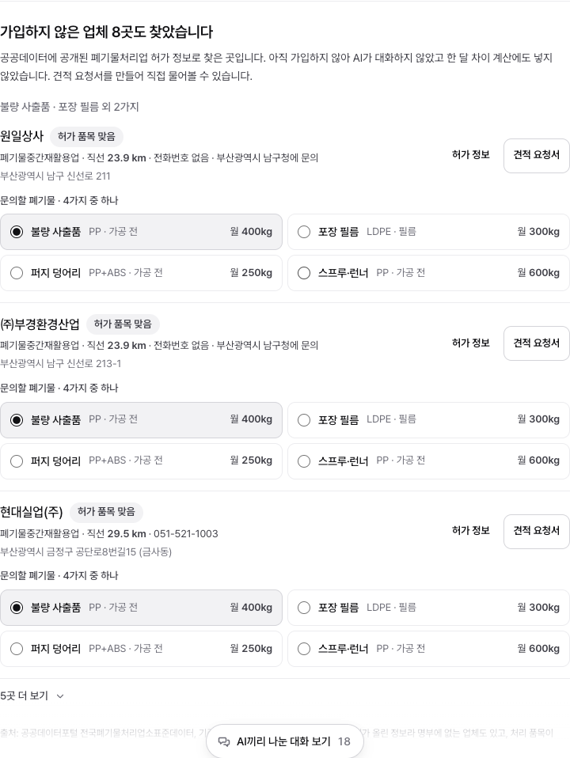
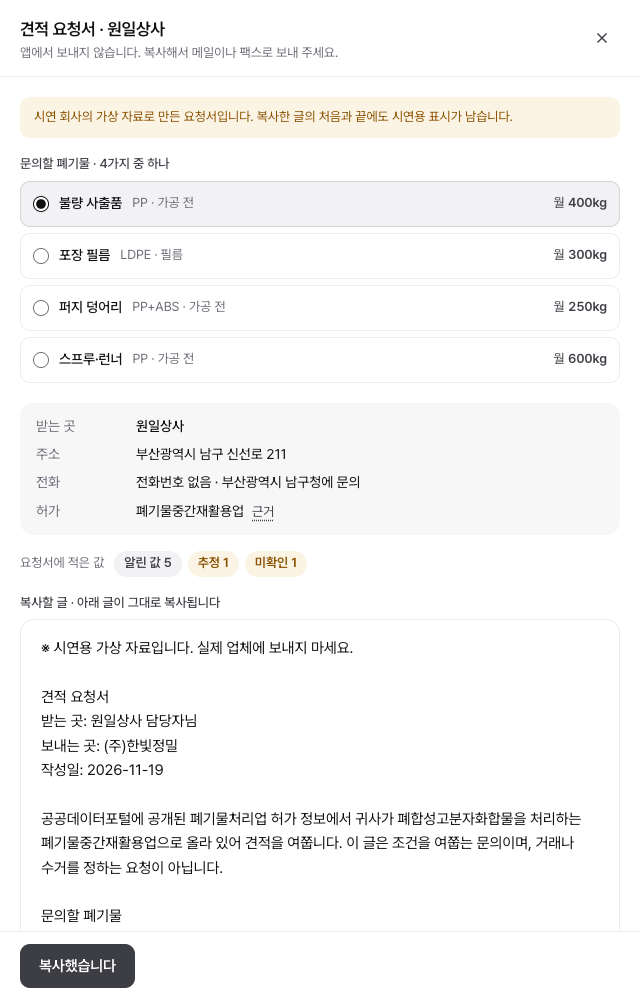
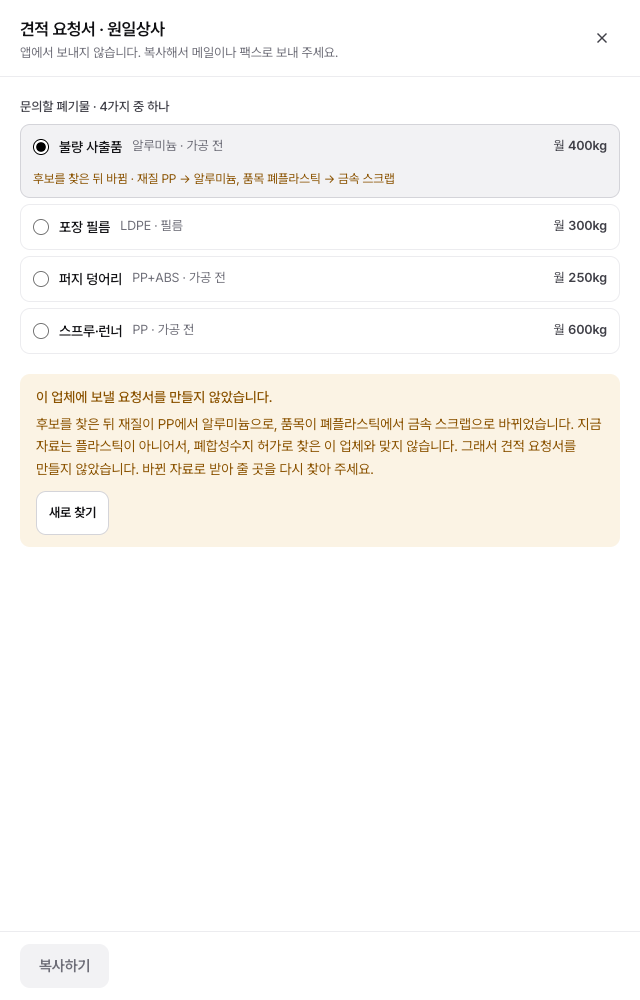

# 견적 요청서 개선 결과 (2026-11-19)

가입하지 않은 업체(공공데이터 허가 명부 후보)에 보내는 견적 요청서를 고쳤다. 업체 카드에서 문의할 폐기물을 고르게 했고, 과거 후보 목록과 바뀐 폐기물 자료가 섞여 잘못된 요청서가 만들어지던 결함을 막았다.

- 커밋: backend `7e94ed4` (main), frontend `5d3e328` (main). VM 배포는 배포를 맡은 세션이 main을 받아 순서대로 한다.
- 시연 데이터: (주)한빛정밀(가상 회사), 후보 업체는 공공데이터포털 전국폐기물처리업소표준데이터의 실제 명부 줄이다.

## 1. 고친 결함

| 결함 | 고치기 전 | 고친 뒤 |
|---|---|---|
| 같은 업체에 다른 폐기물을 물을 수 없음 | `outside-vendors.tsx`가 후보 묶음의 첫 폐기물(`group.streamIds[0]`)만 견적 API로 보냈다. 시연에서 원일상사에 늘 불량 사출품 400kg만 물었다 | 업체 카드와 요청서 서랍에 그 업체가 문의 후보인 폐기물만 라디오로 둔다(이름 · 재질 · 형태 · 월 물량). 고른 업체·폐기물 ID를 API에 보낸다 |
| 늦게 온 이전 응답 | 업체·폐기물을 바꿔도 이전 초안이 남아 있다가 복사될 수 있었다 | 응답은 고른 업체·폐기물 열쇠가 같을 때만 쓴다. 바꾸면 새 응답이 올 때까지 미리보기를 비우고 "복사하기"를 끈다. 업체를 바꾸면 서랍을 새로 연다 |
| 탐색 뒤 재질 변경 | `quote_request()`가 과거 후보 목록만 검사하고 지금 폐기물로 초안을 만들었다. 불량 사출품을 PP에서 알루미늄·금속 스크랩으로 고치자 플라스틱 재활용업체에 알루미늄 견적서가 나왔다(근거 검증도 통과) | 탐색 때 본 흐름 칸을 남기고, 요청서를 만들기 전에 지금 자료로 후보가 맞는지 다시 본다. 맞지 않으면 초안을 만들지 않고 409 `OUTSIDE_STALE`로 바뀐 칸과 다시 찾으라는 안내를 보인다 |
| 탐색 자체의 재질 판정 | `stream_codes`가 재질이 있으면 모두 플라스틱으로 봐서, 알루미늄도 폐합성수지 업체 후보를 받았다 | 알루미늄·철·구리 같은 재질과 금속 스크랩·폐목재는 폐합성수지 분류번호로 찾지 않고 "플라스틱이 아니어서 찾지 않았습니다"를 적는다 |
| 미리보기와 복사 글 | 미리보기는 근거 값 단추로 그리고 복사는 서버 글 + 연락처라 둘이 달랐고, 시연 표시가 없었다 | 미리보기는 서버 조각(`parts`)으로 그려 복사할 글과 글자 하나까지 같다(연락처 줄 포함). 시연 자료면 글의 처음과 끝에 시연 표시가 남는다 |

## 2. 견적서 예시 두 장

브라우저에서 같은 업체(원일상사)에 두 폐기물을 번갈아 고르고 "복사하기"를 눌러 클립보드에서 읽은 글 그대로다. 숫자는 모두 근거가 붙은 값(claim)이고 근거 검증기를 통과했다. 업체에게 가는 글이라 폐기물 이름은 상대에게 보일 이름 규칙으로 정리된다(화면 "스프루·런너" → 글 "PP 스프루·러너").

### 예시 1 · PP 사출 불량품 400kg (사진 추정과 미확인 값이 있는 폐기물)

```text
※ 시연용 가상 자료입니다. 실제 업체에 보내지 마세요.

견적 요청서
받는 곳: 원일상사 담당자님
보내는 곳: (주)한빛정밀
작성일: 2026-11-19

공공데이터포털에 공개된 폐기물처리업 허가 정보에서 귀사가 폐합성고분자화합물을 처리하는 폐기물중간재활용업으로 올라 있어 견적을 여쭙니다. 이 글은 조건을 여쭙는 문의이며, 거래나 수거를 정하는 요청이 아닙니다.

문의할 폐기물
- 품목: PP 사출 불량품
- 재질: PP (담당자 입력)
- 형태: 가공 전 (담당자 입력)
- 출처: 공정에서 나온 것 (담당자 입력)
- 한 달 발생량: 400 kg/월 (계량값)
- 섞인 것: 종이 라벨, 금속 인서트 (담당자 입력)
- 오염도: 6% (사진 추정)
- 수분: 미확인

괄호 안은 값의 출처입니다. 계량값·측정값은 저희가 잰 값이고, 담당자 입력·담당자 답은 담당자가 적은 값입니다. 사진 추정은 사진으로 어림한 값이라 실제와 다를 수 있습니다. 사진 추정과 미확인 값은 시료나 반입 검수로 정해 주세요.

여쭙는 것 (해당하는 곳에 표시하고 빈칸을 채워 주세요)
1. 거래 방식: □ 매입(귀사가 값을 치름) □ 무상 인수 □ 유상 처리(저희가 처리비를 냄)
2. 단가: kg당 ____원 (매입이면 귀사가 주는 값, 유상 처리면 저희가 내는 값)
3. 방문 수거: □ 가능(요일·주기: ____) □ 불가(저희가 직접 반입)
4. 최소 수거량: 한 번에 ____kg 이상
5. 운반비: □ 단가에 포함 □ 별도(한 번에 ____원, 부담: □ 귀사 □ 저희)
6. 그 밖에 저희가 낼 비용: 상하차·계근·선별·잔재물 처리비 등 ____ (없으면 없음)
7. 예상 정산(한 달 발생량 400 kg/월 기준): 귀사가 주는 금액 ____원 − 저희가 내는 비용 ____원 = 한 달에 저희가 □ 받는 돈 □ 내는 돈 ____원
8. 반입 검수 기준(오염도·수분 상한, 섞인 것을 받는지)과 계약에 필요한 서류

회신은 아래 연락처로 부탁드립니다.
연락처: (보내기 전에 적어 주세요)

※ 시연용 가상 자료입니다. 실제 업체에 보내지 마세요.
```

### 예시 2 · PP 스프루·러너 600kg (모두 잰 값인 폐기물)

예시 1과 질문 틀은 같고, 아래 줄만 다르다.

```text
- 품목: PP 스프루·러너
- 한 달 발생량: 600 kg/월 (계량값)
- 섞인 것: 적힌 것 없음 (담당자 입력)
- 오염도: 1% (측정값)
- 수분: 0.3% (측정값)
7. 예상 정산(한 달 발생량 600 kg/월 기준): 귀사가 주는 금액 ____원 − 저희가 내는 비용 ____원 = 한 달에 저희가 □ 받는 돈 □ 내는 돈 ____원
```

화면의 "요청서에 적은 값" 칩은 예시 1이 알린 값 5 · 추정 1 · 미확인 1, 예시 2가 알린 값 7이다.

### 평가 항목에 대응한 부분

| 평가 항목 | 요청서와 화면에서 대응한 부분 |
|---|---|
| 현장 적용성 | 업체 담당자가 체크와 빈칸만 채워 회신한다: 거래 방식(매입 · 무상 인수 · 유상 처리), kg당 단가, 방문 수거 가능 여부와 요일, 한 번 최소 수거량, 운반비 포함·별도와 부담 주체, 상하차·계근·선별·잔재물 처리비처럼 공장이 낼 비용, 한 달 정산식. 정산식은 업체가 주는 돈에서 공장이 낼 비용을 빼 "받는 돈"인지 "내는 돈"인지 고르게 해, 매입이라도 운반비 때문에 공장이 되레 돈을 내는 경우가 드러난다. 메일·팩스에 바로 붙일 수 있고, 회신 연락처는 저장하지 않고 글 끝에만 붙는다 |
| 신뢰성 | 값마다 출처(계량값 · 측정값 · 담당자 입력 · 담당자 답 · 사진 추정 · 추정 · 미확인)를 괄호로 적고, 사진 추정과 미확인 값은 시료나 반입 검수로 정해 달라고 한다. 숫자는 근거 검증기를 거친 값뿐이다. 요청서를 만들 때마다 지금 자료로 그 업체가 허가 분류에 맞는지 다시 본다. 시연 자료는 복사한 글의 처음과 끝에 시연 표시가 남는다. "거래나 수거를 정하는 요청이 아닙니다"를 밝히고, 초안 만들기와 복사는 업체 연락·견적 확정·월 손익 갱신을 하지 않는다 |
| 전달력 | 한 요청서에 한 폐기물만 담는다. 화면은 알린 값 · 추정 · 미확인 칩으로 요약을 먼저 보이고, "아래 글이 그대로 복사됩니다" 아래에 복사할 글을 그대로 보인다. 같은 업체에 다른 폐기물을 물을 때 서랍을 닫지 않고 바꾼다 |





## 3. 재질 변경 반례

절차: 시연 회사로 "받아 줄 곳 찾기" → 결과의 가입하지 않은 업체 후보 8곳(폐합성수지 허가, 원일상사 등) → 자료에서 불량 사출품의 재질을 PP에서 알루미늄으로, 품목을 폐플라스틱에서 금속 스크랩으로 고침 → 원일상사의 견적 요청서를 엶.

고치기 전(backend `c6c0058`, 이번 수정 전 코드)에서 같은 절차를 돌리면 아래 견적서가 근거 검증을 통과한 채 만들어졌다. 폐합성수지 재활용업체에 알루미늄을 묻는 글이다.

```text
공공데이터포털에 공개된 폐기물처리업 허가 정보에서 귀사가 폐합성고분자화합물을 처리하는 폐기물중간재활용업으로 올라 있어 견적을 여쭙니다.

폐기물
- 이름: 알루미늄 사출 불량품
- 재질과 형태: 알루미늄, 가공 전
```

고친 뒤에는 초안을 만들지 않고 409 `OUTSIDE_STALE`을 돌려주며, 화면은 서버 문장과 "새로 찾기"를 보인다. "복사하기"는 꺼진다.

> 이 업체에 보낼 요청서를 만들지 않았습니다.
> 후보를 찾은 뒤 재질이 PP에서 알루미늄으로, 품목이 폐플라스틱에서 금속 스크랩으로 바뀌었습니다. 지금 자료는 플라스틱이 아니어서, 폐합성수지 허가로 찾은 이 업체와 맞지 않습니다. 그래서 견적 요청서를 만들지 않았습니다. 바뀐 자료로 받아 줄 곳을 다시 찾아 주세요.

- 업체 카드의 불량 사출품 줄에도 "후보를 찾은 뒤 바뀜 · 재질 PP → 알루미늄, 품목 폐플라스틱 → 금속 스크랩"이 미리 보인다.
- 불량 사출품의 후보 8곳 모두 같은 409를 받고, 바꾸지 않은 스프루·런너는 그대로 만든다(pytest).
- PP를 PE로 바꾸는 것처럼 플라스틱끼리 바뀌면 그 업체가 여전히 허가 분류에 맞으므로 지금 자료로 요청서를 만들고, 서랍에 "후보를 찾은 뒤 바뀐 자료(재질 PP → PE)로도 이 업체의 허가 품목에 맞아…"를 적는다.



## 4. 변경 파일

backend `7e94ed4`

| 파일 | 바뀐 것 |
|---|---|
| `app/v3/public_vendors/__init__.py` | 비플라스틱 판별(`non_plastic`), 업체 대조 함수 분리(`_vendor_match`), 후보 재확인(`recheck`: 분류번호 · 상호 · 가입 여부 · 반경) |
| `app/v3/outreach.py` | 탐색 때 본 칸(`stream_basis`), 바뀐 칸(`basis_changes`), 안내 문장(`stale_message`), 요청서 본문(값 출처, 정산 질문, 시연 표시), 응답 필드(`vendorId`, `demo`, `item`, `facts`, `changes`, `parts`) |
| `app/v3/service.py` | `quote_request()`에서 지금 자료로 재확인하고 409 `OUTSIDE_STALE`, 결과 한 장의 후보 목록에 `changed`·`removed`(`_outside_view`) |
| `app/v3/agents/orchestrator.py` | 탐색 때 `work.outsideBasis` 기록 |
| `docs/v3/CONTRACT.md` | 견적 요청서 응답 모양, 오류 코드 `OUTSIDE_STALE` |
| `tests/v3/test_outreach.py`, `tests/v3/test_public_vendors.py` | 아래 시험 |

frontend `5d3e328`

| 파일 | 바뀐 것 |
|---|---|
| `src/components/agent/outside-vendors.tsx` | 문의할 폐기물 고르기(카드·서랍), 늦은 응답 거르기, 미리보기 = 복사 글, 값 출처 칩, 시연 띠, 409 안내와 "새로 찾기" |
| `src/lib/v3/outside.ts` | 순수 함수(`vendorStreamIds`, `quoteKey`, `isQuoteFor`, `quoteCopy`, `quotePreview`, `factCounts`, `streamChanges`, `changesText`, `itemMeta`) |
| `src/lib/v3/types.ts`, `schema.ts`, `errors.ts` | 응답 타입, `changed`·`removed` 스키마, `OUTSIDE_STALE` 서버 문장 그대로 보이기 |
| `src/components/agent/conversation.tsx` | "새로 찾기"를 견적 서랍에 넘김 |
| `tests/outside.test.ts`, `tests/v3-errors.test.ts`, `tests/fixtures/quote-requests.json` | 백엔드가 만든 실제 응답 두 장으로 본 시험 |

docs(이 커밋): `DESIGN.md`의 "가입하지 않은 업체" 규칙과 결정 기록, 구현 상태 ④ 업체 탐색, 이 문서와 화면 그림.

## 5. 시험 결과

| 범위 | 결과 |
|---|---|
| backend pytest 전체 | 1626 통과, 6 건너뜀, 0 실패(5분 54초). rebase로 들어온 `c6c0058`은 `infra/h100/h100.sh`만 바꿔 관련 시험만 다시 돌렸다 |
| backend ruff | `ruff check .` 통과, 고친 파일 `ruff format --check` 통과 |
| backend 새 시험 | 같은 업체에 불량 사출품 ↔ 스프루 번갈아 만들기(조각을 이으면 복사 글), 정산 질문과 값 출처, 시연 표시 있음·없음, 초안을 만들어도 저장소·근거·월 손익이 그대로, PP → 알루미늄이면 후보 8곳 모두 409, PP → PE면 지금 자료로 만듦, 비플라스틱은 탐색 후보 없음, `recheck`의 이유 여섯 가지(분류번호가 다른 경우는 탐색 시험이 본다) |
| frontend 단위 시험 | `node --test tests/*.test.ts` 203개 중 201 통과, 2 건너뜀(기존), 0 실패 |
| frontend 정적 검사·빌드 | `eslint`, `tsc --noEmit`, `next build` 통과 |
| 브라우저 완료 시험 | 로컬 백엔드(규칙 정책) + `next dev`, Chrome, `.qa/quote.mjs` 29/29 통과(아래) |

브라우저 완료 시험 항목

- 카드에는 그 업체가 후보인 폐기물만 나온다(이름 · 재질 · 형태 · 월 물량)
- 불량 사출품 → 스프루·런너 → 불량 사출품 → 스프루·런너를 번갈아 고를 때마다 화면 글과 클립보드 글이 같고, 400kg 글에는 600kg이 없고 그 반대도 같다. 다시 골라도 같은 글이 나온다
- 시연 표시가 복사한 글의 처음과 끝에 남는다
- 불량 사출품 응답을 2.5초 늦추고 바로 스프루로 바꾸면: 기다리는 동안 이전 글이 보이지 않고 "복사하기"가 꺼져 있으며, 늦은 응답이 도착한 뒤에도 화면과 복사 글은 스프루다
- 첫 업체의 응답을 늦춘 채 닫고 다른 업체를 열면: 그 업체의 머리·받는 곳·복사 글만 보이고, 늦은 응답 뒤에도 바뀌지 않는다
- 초안 만들기와 복사 동안 `/api/v3`로 GET 말고 다른 요청이 없다(업체 연락, 견적 확정, 손익 갱신 없음)
- 탐색 뒤 불량 사출품을 알루미늄·금속 스크랩으로 고치면: 카드에 바뀐 칸이 미리 보이고, 원일상사 요청서를 만들지 않으며 다시 찾으라고 안내한다. 스프루·런너는 그대로 만든다
- 390px 폭에서 가로로 넘치지 않는다

## 6. 남은 한계

- 브라우저 시험은 로컬 개발 서버에서 했다. VM에 배포한 뒤의 화면은 아직 보지 않았다.
- 공공 명부 검색은 폐합성수지 재활용업만 다룬다. 알루미늄·금속 스크랩은 후보를 찾지 않고 그 이유만 적는다.
- 탐색 때 본 칸을 남기지 않은 이전 찾기에는 카드의 "바뀜" 표시가 없다. 그래도 요청서를 만들 때 지금 자료로 허가 분류를 다시 보므로 알루미늄 견적서는 만들어지지 않는다.
- 개발 서버 콘솔에 `/login`·`/app`의 `crypto.getRandomValues()` 사전 렌더링 경고 5건이 있다. 이번 변경과 무관한 기존 경고다.
